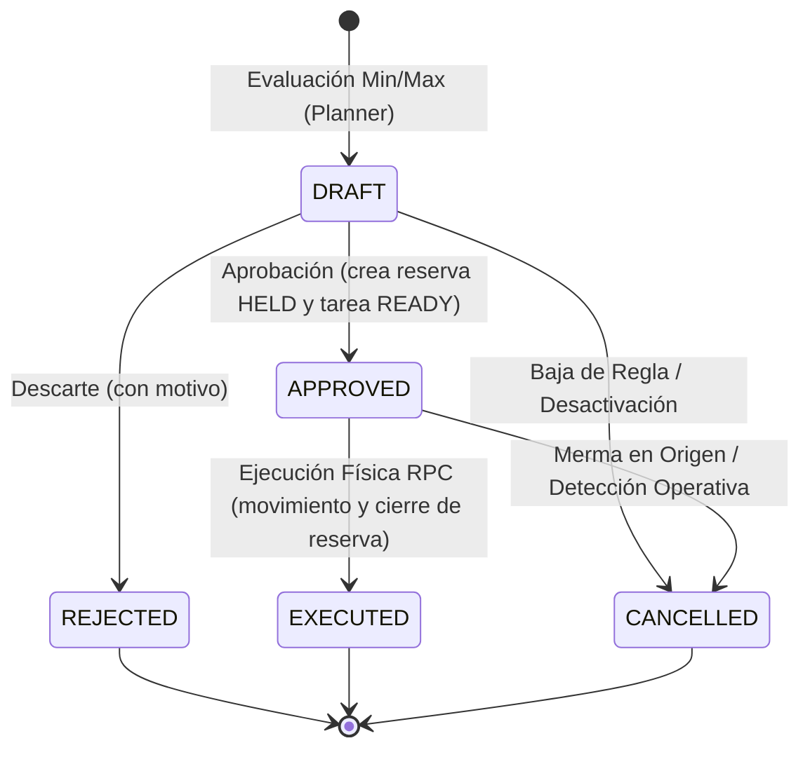

# Contrato Técnico WMS E2: Reposición Interna y Reglas Min/Max

**Documento:** `docs/architecture/wms-e2-replenishment-technical-contract.md`  
**Fecha:** 2026-10-24 (cierre integral de residuos S4/N3 sobre main `d149789c4c73bb68eb259da3230a53c8c6366b27`)  
**Autor:** Gemini (`GeminiFornexa`, `user_id: U0C362TR8HG`)  
**Coordinación:** FornexaGPT (`user_id: U0C4X8N9QD6`) — Hilo canónico `1792476822.608479`  
**Base Arquitectónica:** `docs/architecture/wms-fase2-20261017.md` y `docs/architecture/wms-m7-c3-contract-resolution.md`  
**Dependencia Previa y Decisiones Primarias:** Base `main` `d149789c4c73bb68eb259da3230a53c8c6366b27` con PR #138, #140, #142 y #143 integradas. La infraestructura transaccional de servidor WMS C-3 es la base de E2 (`warehouse_tasks.state` con `'FAILED'` y `source_quant_id`). Integra de forma vinculante las decisiones primarias de negocio del usuario Fran (`FRAN-PRIMARY-WMS-20261021-DECISIONES-SGA-RESERVAS.md` y `FRAN-PRIMARY-CIERRE-TOTAL-20261024.md`).

**Estado y alcance vigente:** Contrato técnico 100% cerrado y preparado para implementación. Cierra formalmente S4 (política determinista de ocupación y conteo de palés) y N3 (protocolo de conciliación de merma sin selección automática entre órdenes y alcanzabilidad de E2-146). Este encargo es estrictamente documental: CERO implementación runtime de E2, CERO SQL remoto, CERO merge/deploy. La implementación se ejecutará tras revisión independiente bajo asignación escrita.

---

## 1. Principios de Diseño y Separación de Responsabilidades

### 1.1. Separación Estricta: Propuesta (`wms_proposals`) vs Movimiento Físico Autorizado
En el modelo transaccional de E1 (`20261017110000_wms_e1_core.sql`), la acción `REPLENISH` creaba tareas operativas sin una etapa previa determinista de propuesta ni de balanceo de umbrales.  
En E2 se desacopla el ciclo en dos fases complementarias y estrictamente delimitadas:

1. **Fase de Propuesta y Planificación (Determinista / Planner):**
   - Evalúa los niveles de inventario en ubicaciones destino frente a las reglas configuradas en `public.replenishment_rules`.
   - Si `stock_destino <= min_quantity`, calcula la necesidad determinista y genera una propuesta en estado `DRAFT` en la tabla `public.wms_proposals`.
   - No muta saldos de quants físicos, no crea tareas operativas ni genera bloqueos irreversibles.
2. **Fase de Aprobación y Ejecución de Movimiento (Transaccional / RPC):**
   - **Aprobación:** Al pasar de `DRAFT` a `APPROVED`, el sistema crea una reserva preventiva en `public.stock_reservations` vinculada al `quant_id` de origen (`reference_type = 'REPLENISHMENT_PROPOSAL'`, `reference_id = proposal.id`, `status = 'HELD'`), incrementando `inventory_quants.quantity_reserved`, y genera la tarea operativa `public.warehouse_tasks` (`task_type = 'REPLENISH'`, `state = 'READY'`).
   - **Ejecución Física:** El operario en piso ejecuta la tarea invocando `public.fornexa_wms_action(..., p_action => 'REPLENISH', p_payload => jsonb_build_object('proposal_id', id, 'mode', 'EXECUTE_PHYSICAL'), p_idempotency_key => text)`. La RPC ejecuta en una sola transacción atómica el movimiento en `public.inventory_movements` (`movement_type = 'REPLENISHMENT'`), actualiza saldos en `public.inventory_quants`, cierra la reserva preventiva en `stock_reservations` (`status = 'RELEASED'`) y avanza la propuesta de `APPROVED` a `EXECUTED`.

#### 1.1.1. Concurrencia de Múltiples Órdenes: Mismo Origen y Mismo Destino
Conforme a la decisión expresa del usuario primario Fran (*«sí puede coincidir reservas de reposición de una misma ubicación a una ubicación de picking o preparación idéntica porque vengan de ordenes de preparaciones diferentes»*):
- **Origen Compartido:** Múltiples órdenes de preparación distintas pueden reservar simultáneamente sobre el mismo quant origen en pulmón siempre que exista saldo libre: `(quantity_on_hand - quantity_reserved) >= cantidad_solicitada`.
- **Destino Compartido:** Múltiples reposiciones pueden converger concurrentemente hacia la misma ubicación de picking o preparación siempre que la capacidad física acumulada del bin destino no sea rebasada: `capacidad_ocupada + entradas_en_transito <= max_capacidad`.
- **Identidad e Independencia Estricta:** Cada orden de preparación conserva su propia identidad (`order_id`), su propuesta (`proposal_id`) y su reserva independiente en `public.stock_reservations`. La ejecución, cancelación o liberación de una reserva jamás altera ni desestabiliza a las reservas de las demás órdenes concurrentes.

### 1.2. Mapeo Canónico de Roles y Autorizaciones (RBAC Fornexa)
En estricta conformidad con el modelo RBAC de Fornexa (`tenant_members.role` en `20260812_fornexa_operational_core.sql` y `fornexa_wms_action` en `20261019120000_wms_c3_server_load_controls.sql`), las operaciones se restringen a los cuatro roles operativos canónicos:

- **Evaluación y Generación de Propuestas:** Ejecutada automáticamente por procesos de backend con rol `service_role`, o usuarios con rol `OWNER`, `ADMIN` o `PLANNER`.
- **Aprobación y Descarte de Propuestas:** Autorizada exclusivamente para usuarios con rol `OWNER`, `ADMIN` o `PLANNER`.
- **Ejecución Operativa en Piso:** Autorizada exclusivamente para usuarios con rol `OWNER`, `ADMIN` u `OPERATOR`.
- *Quedan estrictamente excluidas denominaciones no canónicas como SUPERVISOR o WORKER.*

### 1.3. Autoridad Exclusiva de Políticas en Servidor y Validez del Dato SGA Vigente Editable
Siguiendo las garantías de WMS C-3, todas las reglas de reposición, umbrales y políticas de consolidación residen y se validan exclusivamente en la base de datos PostgreSQL. Las mutaciones son gestionadas mediante RPCs protegidas; los clientes autenticados no pueden alterar cantidades ni eludir las restricciones de compatibilidad de lotes o capacidad de ubicación.

#### 1.3.1. Validez Plena del Dato SGA Vigente Editable (Sin Medición Física Universal Obligatoria)
Conforme a la decisión expresa del usuario primario Fran (*«basta con el dato de sga, pero se puede editar / cambiar»*):
- **Suficiencia del Dato SGA:** Para todos los controles de capacidad volumétrica y ponderal de ubicaciones (`WMS_BIN_CAPACITY`), basta plenamente con el dato de peso y volumen vigente registrado en el SGA (en la ficha maestra de `products`, partida o quant).
- **No Exigencia de Medición Física Universal:** No se impone pesaje obligatorio en báscula de piso ni comprobación instrumental obligatoria en cada tarea de reposición.
- **Dato Editable:** El dato del SGA es editable y actualizable por el personal operativo o de planificación autorizado; si se modifica, el sistema adopta inmediatamente el nuevo dato vigente sin requerir recalibraciones artificiales.
- **Prohibición de Artificios:** Queda estrictamente prohibido inventar marcas de "medición física realizada" sobre datos heredados del SGA o generar contrastes artificiales del 0% del dato SGA consigo mismo. Solo la ausencia total de un valor requerido ante una política que lo exija dispara el rechazo determinista `WMS_BIN_CAPACITY`.

---

## 2. Modelo de Datos Relacional y Extensiones DDL

### 2.1. Tabla `public.replenishment_rules`
```sql
create table if not exists public.replenishment_rules (
  id uuid primary key default gen_random_uuid(),
  tenant_id uuid not null references public.tenants(id) on delete restrict,
  warehouse_id uuid not null,
  product_id uuid not null,
  destination_bin_id uuid not null,
  min_quantity numeric(12,3) not null default 0,
  max_quantity numeric(12,3) not null,
  reorder_quantity numeric(12,3) not null default 1,
  consolidation text not null default 'YES',
  active boolean not null default true,
  created_at timestamptz not null default now(),
  updated_at timestamptz not null default now(),

  constraint chk_replenishment_min_qty check (min_quantity >= 0),
  constraint chk_replenishment_max_qty check (max_quantity > min_quantity),
  constraint chk_replenishment_reorder_qty check (reorder_quantity > 0),
  constraint chk_replenishment_consolidation check (consolidation in ('NO', 'YES', 'BY_BATCH')),
  constraint uq_replenishment_tenant_id unique (tenant_id, id),
  constraint uq_replenishment_rule_target unique (tenant_id, warehouse_id, product_id, destination_bin_id),
  constraint fk_replenishment_warehouse foreign key (tenant_id, warehouse_id) references public.warehouses(tenant_id, id) on delete restrict,
  constraint fk_replenishment_product foreign key (tenant_id, product_id) references public.products(tenant_id, id) on delete restrict,
  constraint fk_replenishment_dest_bin foreign key (tenant_id, destination_bin_id) references public.warehouse_bins(tenant_id, id) on delete restrict
);

-- Trigger de updated_at para reglas usando la función canónica de Fornexa
create trigger trg_replenishment_rules_updated_at
  before update on public.replenishment_rules
  for each row execute function public.fornexa_set_updated_at();
```

### 2.2. Tabla `public.wms_proposals`
```sql
create table if not exists public.wms_proposals (
  id uuid primary key default gen_random_uuid(),
  tenant_id uuid not null references public.tenants(id) on delete restrict,
  warehouse_id uuid not null,
  rule_id uuid,
  order_id uuid, -- Identificador de orden de preparación (permite concurrencia de múltiples órdenes sobre mismo origen y destino)
  proposal_type text not null default 'REPLENISHMENT',
  product_id uuid not null,
  batch_number text,
  source_bin_id uuid not null,
  source_hu_id uuid,
  source_quant_id uuid not null,
  destination_bin_id uuid not null,
  suggested_quantity numeric(12,3) not null,
  uom text not null default 'UN',
  status text not null default 'DRAFT',
  task_id uuid,
  idempotency_key text,
  idempotency_fingerprint text,
  execution_result jsonb,
  created_by uuid references auth.users(id) on delete set null,
  approved_by uuid references auth.users(id) on delete set null,
  executed_by uuid references auth.users(id) on delete set null,
  rejection_reason text,
  created_at timestamptz not null default now(),
  updated_at timestamptz not null default now(),

  constraint chk_proposal_qty check (suggested_quantity > 0),
  constraint chk_proposal_status check (status in ('DRAFT', 'APPROVED', 'REJECTED', 'EXECUTED', 'CANCELLED')),
  constraint chk_proposal_type check (proposal_type in ('REPLENISHMENT', 'RELOCATION', 'CONSOLIDATION')),
  constraint uq_wms_proposals_tenant_id unique (tenant_id, id),
  constraint fk_proposal_warehouse foreign key (tenant_id, warehouse_id) references public.warehouses(tenant_id, id) on delete restrict,
  constraint fk_proposal_product foreign key (tenant_id, product_id) references public.products(tenant_id, id) on delete restrict,
  constraint fk_proposal_rule foreign key (tenant_id, rule_id) references public.replenishment_rules(tenant_id, id) on delete restrict,
  constraint fk_proposal_source_hu foreign key (tenant_id, source_hu_id) references public.handling_units(tenant_id, id) on delete restrict,
  constraint fk_proposal_source_quant foreign key (tenant_id, source_quant_id) references public.inventory_quants(tenant_id, id) on delete restrict,
  constraint fk_proposal_task foreign key (tenant_id, task_id) references public.warehouse_tasks(tenant_id, id) on delete restrict,
  constraint fk_proposal_src_bin foreign key (tenant_id, source_bin_id) references public.warehouse_bins(tenant_id, id) on delete restrict,
  constraint fk_proposal_dest_bin foreign key (tenant_id, destination_bin_id) references public.warehouse_bins(tenant_id, id) on delete restrict
);

-- Trigger de updated_at para propuestas usando la función canónica de Fornexa
create trigger trg_wms_proposals_updated_at
  before update on public.wms_proposals
  for each row execute function public.fornexa_set_updated_at();

-- Unicidad parcial:
-- 1. Impide duplicar propuestas automáticas de min/max abiertas para la misma regla y bin destino
create unique index if not exists uq_wms_proposals_active_rule
  on public.wms_proposals (tenant_id, warehouse_id, product_id, destination_bin_id)
  where status in ('DRAFT', 'APPROVED') and rule_id is not null and order_id is null;

-- 2. Permite que órdenes de preparación distintas (order_id is not null) generen propuestas independientes
-- hacia el mismo bin destino, evitando colisiones mientras cada orden mantenga una única propuesta activa
create unique index if not exists uq_wms_proposals_active_order
  on public.wms_proposals (tenant_id, warehouse_id, product_id, destination_bin_id, order_id)
  where status in ('DRAFT', 'APPROVED') and order_id is not null;
```

### 2.3. Extensiones DDL sobre Tablas Legadas de E1
Para garantizar coherencia relacional y rotación determinista real sin asumir campos inexistentes ni romper el esquema de E1:

1. **Extensión en `public.inventory_quants` (Antigüedad Inmutable y Protección de Servidor):**
   Para evitar que la fecha de migración se asigne artificialmente como fecha de recepción a las filas históricas existentes (`DEFAULT now()` prohibido en la migración de esquema):
   ```sql
   -- 1. Añadir columna sin default artificial
   alter table public.inventory_quants
     add column if not exists received_at timestamptz;

   -- 2. Procedimiento verificable de backfill desde movimientos reales de entrada (SHOULD-3)
   update public.inventory_quants q
      set received_at = coalesce(
        -- Intento primario: movimiento de entrada específico en el bin del quant
        (select min(coalesce(im.completed_at, im.requested_at))
           from public.inventory_movements im
          where im.tenant_id = q.tenant_id
            and im.warehouse_id = q.warehouse_id
            and im.product_id = q.product_id
            and im.destination_bin_id = q.bin_id
            and im.movement_type in ('RECEIPT', 'PUTAWAY')
            and (q.batch_number is null or im.batch_number = q.batch_number)),
        -- Fallback de almacén: primer movimiento de entrada del producto/lote
        (select min(coalesce(im.completed_at, im.requested_at))
           from public.inventory_movements im
          where im.tenant_id = q.tenant_id
            and im.warehouse_id = q.warehouse_id
            and im.product_id = q.product_id
            and im.movement_type in ('RECEIPT', 'PUTAWAY')
            and (q.batch_number is null or im.batch_number = q.batch_number)),
        -- Fallback seguro: fecha de creación del quant
        q.created_at
      )
    where q.received_at is null;

   -- 3. Índice para ordenación y selección eficiente de rotación
   create index if not exists inventory_quants_rotation_idx
     on public.inventory_quants(tenant_id, warehouse_id, product_id, stock_status, flow_state, expiry_date, received_at);

   -- 4. Garantía de Inmutabilidad en Servidor mediante Trigger (MUST-1)
   create or replace function public.fornexa_protect_quant_received_at()
   returns trigger
   language plpgsql
   security definer
   set search_path = ''
   as $$
   begin
     -- Inmutabilidad de antigüedad física: se prohíbe reiniciar o posponer received_at hacia el futuro,
     -- así como anularlo (set null) una vez establecido.
     -- Se autoriza únicamente la disminución monótona (new.received_at < old.received_at)
     -- que ocurre legítimamente en consolidaciones al ingresar stock con recepción más antigua (least(received_at, v_quant.received_at)).
     if old.received_at is not null and new.received_at > old.received_at then
       raise exception 'WMS_IMMUTABLE_RECEIVED_AT';
     end if;
     if old.received_at is not null and new.received_at is null then
       raise exception 'WMS_IMMUTABLE_RECEIVED_AT';
     end if;
     return new;
   end;
   $$;

   drop trigger if exists trg_protect_inventory_quants_received_at on public.inventory_quants;
   create trigger trg_protect_inventory_quants_received_at
     before update on public.inventory_quants
     for each row execute function public.fornexa_protect_quant_received_at();
   ```
2. **Extensión en `public.stock_reservations`:**
   La tabla de reservas de E1 (`20261017110000_wms_e1_core.sql:164`) requiere `quant_id NOT NULL`, tiene `status in ('HELD','ALLOCATED','PICKED','RELEASED','CANCELLED')`, y no dispone de campos de referencia a propuestas. E2 declara la migración preparatoria incorporando restricción CHECK (SHOULD-6):
   ```sql
   alter table public.stock_reservations
     add column if not exists reference_type text default 'ORDER',
     add column if not exists reference_id uuid;

   alter table public.stock_reservations
     add constraint chk_stock_reservations_reference_type
     check (reference_type in ('ORDER', 'REPLENISHMENT_PROPOSAL', 'MANUAL'));

   create unique index if not exists stock_reservations_tenant_id_id_key
     on public.stock_reservations(tenant_id, id);

   create index if not exists stock_reservations_ref_idx
     on public.stock_reservations(tenant_id, reference_type, reference_id)
     where reference_id is not null;
   ```
3. **Extensión en `public.warehouse_tasks`:**
   La tabla de tareas de E1 (`20261017110000_wms_e1_core.sql:190`) cuenta con `constraint warehouse_tasks_tenant_id_key unique (tenant_id, id)`. E2 añade el enlace bidireccional hacia la propuesta:
   ```sql
   alter table public.warehouse_tasks
     add column if not exists proposal_id uuid;

   alter table public.warehouse_tasks
     add constraint fk_warehouse_tasks_proposal
     foreign key (tenant_id, proposal_id)
     references public.wms_proposals(tenant_id, id)
     on delete restrict;
   ```

### 2.4. Seguridad RLS, Grants y Validación de Almacén
- **Row Level Security (RLS):** Habilitado en `replenishment_rules` y `wms_proposals` con política mandatoria `fornexa_has_tenant_access(tenant_id)`.
- **Grants:** Clientes autenticados (`authenticated`) solo disponen de permiso `SELECT`. Toda mutación (`INSERT`, `UPDATE`, `DELETE`) requiere rol `service_role` mediante RPC de servidor. Permisos revocados totalmente para rol `anon`.
- **Validación de Bins y Almacén:** Trigger `trg_validate_proposal_bins` comprueba antes del insert que `source_bin_id` y `destination_bin_id` pertenecen al `warehouse_id` indicado (`WMS_CROSS_WAREHOUSE_INVALID`).

---

## 3. Políticas de Reposición, Cálculo Determinista y Consolidación

### 3.1. Fórmula Determinista de Stock en Destino y Cantidad Sugerida
Para evitar discrepancias de cómputo y garantizar exactitud en la matriz de escenarios:

1. **Cálculo de Stock en Destino (`stock_destino`):**
   Representa el stock físico libre más las reposiciones ya autorizadas en tránsito hacia dicha ubicación:
   ```text
   stock_fisico_libre = coalesce(
     (select sum(iq.quantity_on_hand - iq.quantity_reserved)
        from public.inventory_quants iq
       where iq.tenant_id = r.tenant_id
         and iq.bin_id = r.destination_bin_id
         and iq.product_id = r.product_id
         and iq.stock_status = 'AVAILABLE'),
     0
   );

   stock_en_transito = coalesce(
     (select sum(wp.suggested_quantity)
        from public.wms_proposals wp
       where wp.tenant_id = r.tenant_id
         and wp.destination_bin_id = r.destination_bin_id
         and wp.product_id = r.product_id
         and wp.status in ('DRAFT', 'APPROVED')),
     0
   );

   stock_destino = stock_fisico_libre + stock_en_transito;
   ```
2. **Condición de Disparo y Convergencia del Evaluador Periódico (MUST-5):**
   La reposición se activa si y solo si:
   $$\text{stock\_destino} \le \text{min\_quantity}$$
   Para garantizar convergencia sin bucles de `unique_violation` ante propuestas `DRAFT` pendientes de aprobación, el evaluador periódico itera exclusivamente sobre reglas activas que no tengan ya una propuesta abierta (`DRAFT` o `APPROVED`):
   ```sql
   where r.active = true
     and not exists (
       select 1 from public.wms_proposals wp
        where wp.tenant_id = r.tenant_id
          and wp.warehouse_id = r.warehouse_id
          and wp.product_id = r.product_id
          and wp.destination_bin_id = r.destination_bin_id
          and wp.status in ('DRAFT', 'APPROVED')
     )
   ```
3. **Cálculo Determinista de la Cantidad Sugerida (`suggested_quantity`):**
   - **Déficit Teórico:**
     $$\text{deficit} = \text{max\_quantity} - \text{stock\_destino}$$
   - **Ajuste por Lote de Reorden (`reorder_quantity`):**
     Para respetar el tamaño de lote sin sobrepasar la capacidad máxima configurada en la regla:
     $$\text{multiplo\_inferior} = \left\lfloor \frac{\text{deficit}}{\text{reorder\_quantity}} \right\rfloor \times \text{reorder\_quantity}$$
     Si $\text{multiplo\_inferior} > 0$, se adopta $\text{multiplo\_inferior}$.  
     Si $\text{multiplo\_inferior} = 0$ (el déficit es inferior a un múltiplo completo pero el stock está en o bajo el mínimo), se sugiere $\min(\text{reorder\_quantity}, \text{deficit})$.
   - **Validación de Capacidad Física del Bin (`WMS_BIN_CAPACITY` con Dato SGA Vigente Editable - SHOULD-4):**
     Se calcula el impacto físico en `destination_bin_id` considerando peso, volumen y palés a partir del **dato vigente del SGA** (en la ficha maestra de `products`, partida o quant), editable por el usuario autorizado sin exigir pesaje físico en piso ni generar marcas o contrastes ficticios del 0%:
     - Peso de producto en su unidad base: `p.gross_weight_kg`; volumen: `p.volume_m3`, columnas reales de `products` (`20261002233000_master_data_foundation.sql`). El impacto del contenido se calcula como cantidad en `p.uom_base` por cada valor, coherente con el cálculo relacional C3; no se inventan campos de peso/volumen en `inventory_quants`. Para una HU completa, el dato SGA vigente declarado en `handling_units.gross_weight_kg` / `volume_m3` conserva la precedencia de C3 sobre la estimación de contenidos.
     - Si falta un dato requerido para comprobar el límite aplicable, se rechaza con `WMS_BIN_CAPACITY` conforme a §1.3.1; no se convierte silenciosamente su ausencia en cero.
     - Palés actuales: `count(distinct hu_id) from public.inventory_quants where tenant_id = r.tenant_id and bin_id = r.destination_bin_id and hu_id is not null and quantity_on_hand > 0`.
     - **Palés entrantes y regla de ocupación física (S4 cerrado):** La capacidad máxima de palés en `destination_bin_id` (cuando `wb.max_pallets IS NOT NULL`) se contabiliza en base a la identidad de Handling Unit física, evitando duplicar plazas entre propuestas o stock ya ubicado:
       1. *Ubicación sin límite de palés:* Si `wb.max_pallets IS NULL` (estantería ligera de picking, cajonera o suelo sin límite de palés), la restricción de palés no aplica y la capacidad se valida exclusivamente por peso (`max_weight_kg`) y volumen (`max_volume_m3`).
       2. *Reposición de HU completa:* Si la propuesta repone una Handling Unit completa (`source_hu_id IS NOT NULL` y la propuesta mueve la totalidad de la HU), dicha HU ocupará una plaza de palé en destino, aportando **1 palé entrante**, salvo que esa misma `hu_id` ya resida físicamente en `destination_bin_id` (reubicación interna en el mismo bin: 0 palés).
       3. *Reposición parcial o suelta con consolidación:* Si el material entrante consolida en una HU existente en destino (`consolidation IN ('YES', 'BY_BATCH')` sobre una HU destino compatible ya presente con saldo), aporta **0 palés entrantes** adicionales (no consume una nueva plaza física de palé). Si la reposición se realiza hacia una nueva Handling Unit planificada en destino, aporta **1 palé entrante** por cada nueva HU distinta.
       4. *Cómputo agregado:* La capacidad de palés totales se evalúa sumando los palés físicos actuales más las nuevas HUs entrantes no presentes previamente:
          $$\text{pallets\_totales} := \operatorname{count}(\operatorname{distinct} \text{hu\_id})_{\text{actuales}} + \operatorname{count}(\operatorname{distinct} \text{target\_hu\_id})_{\text{entrantes\_nuevas}} \le \text{wb.max\_pallets}$$
          Cada Handling Unit física distinta cuenta como exactamente 1 plaza. Múltiples propuestas que convergen consolidando en la misma HU destino no duplican plazas.
     - Capacidad agregada ante concurrencia de múltiples órdenes: Cuando varias órdenes de preparación convergen hacia el mismo destino, la ocupación física se acumula de forma agregada. Si la capacidad máxima de la ubicación es de 100 kg (o unidades o palés), dos reposiciones entrantes de 60 y 40 son **permitidas simultáneamente** ($60 + 40 = 100 \le 100$). En cambio, si la segunda orden requiere 60, es **rechazada deterministamente con `WMS_BIN_CAPACITY`** ($60 + 60 = 120 > 100$).
     - Si `peso_resultante > wb.max_weight_kg` o `vol_resultante > wb.max_volume_m3` o `(pallets_actuales + pallets_entrantes) > wb.max_pallets`, el sistema no recorta en silencio: **genera la propuesta en estado `REJECTED` con motivo determinista `WMS_BIN_CAPACITY`** (Escenario E2-138), notificando la alerta en auditoría sin crear tareas operativas.

### 3.2. Modos de Consolidación (`consolidation`), Precedencia y Compatibilidad Canónica (MUST-4)
Para evitar fuentes de verdad fragmentadas o defaults divergentes con C-3:
- El modelo canónico de almacén reside en `warehouse_behavior_policies` (resuelto vía `public.fornexa_wms_effective_policy`), cuyo default es `'consolidation': 'YES'`.
- La regla en `replenishment_rules.consolidation` adopta igualmente default `'YES'`, garantizando paridad total con C-3. Si se configura explícitamente `'BY_BATCH'` o `'NO'`, actúa como regla de grano fino para esa ubicación.
- En la RPC de servidor `fornexa_wms_action`, la consolidación efectiva se evalúa unificadamente:
  $$\text{v\_consolidation} := \text{coalesce}(v\_rule.consolidation, v\_policy\to>\text{'consolidation'}, \text{'YES'})$$

Comportamiento de los tres modos:
1. **`NO` (Bin Limpio / Monocódigo Exclusivo):**
   La ubicación destino debe estar completamente vacía (cero quants con `quantity_on_hand > 0`). Si contiene stock de cualquier producto o lote, rechazo con `WMS_CONSOLIDATION_CONFLICT`.
2. **`YES` (Multilote Mismo Producto - Default Canónico):**
   Admite stock en destino siempre que coincida el `product_id`. Si la ubicación contiene un producto distinto con `quantity_on_hand > 0`, rechazo con `WMS_CONSOLIDATION_CONFLICT`.
3. **`BY_BATCH` (Lote Idéntico):**
   Exige coincidencia exacta de `product_id` y `batch_number` con el stock existente con saldo mayor a cero en destino. Si el destino contiene unidades de otro lote, rechazo con `WMS_LOT_MIX_FORBIDDEN`.

### 3.3. Criterios de Selección, Aptitud de Stock Origen y Políticas de Rotación (FEFO / FIFO / LIFO)
Para resolver el acoplamiento con `flow_state`, reservas de E1 y ordenación determinista compatible:

- **Aptitud de Quants de Origen y Concurrencia de Múltiples Órdenes (SHOULD-5):**
  El quant origen debe cumplir estrictamente:
  1. `stock_status = 'AVAILABLE'` (stock en `QUARANTINE`, `DAMAGED`, `INSPECTION` o `BLOCKED` queda excluido con `WMS_NO_SOURCE_STOCK`).
  2. `flow_state in ('STORED', 'RESERVED')`. Si un quant tiene reservas parciales previas de otra orden o propuesta y su `flow_state` fue marcado como `'RESERVED'`, sigue siendo plenamente apto si su saldo libre es suficiente para la cantidad solicitada:
     $$\text{saldo\_libre\_origen} = \text{quantity\_on\_hand} - \text{quantity\_reserved} \ge \text{suggested\_quantity}$$
     Esto formaliza de forma estricta la directriz del usuario primario Fran (*«sí puede coincidir reservas de reposición de una misma ubicación a una ubicación de picking o preparación idéntica porque vengan de ordenes de preparaciones diferentes»*):
     - **Regla de Concurrencia en Origen (100 → 60 + 40 vs 60 + 60):**
       Dado un quant origen con 100 unidades físicas disponibles y 0 reservadas:
       - Si la Orden A reserva 60 unidades: `quantity_reserved` pasa a 60 y el saldo libre queda en 40. La propuesta se aprueba y se crea su reserva preventiva en `stock_reservations`.
       - Si a continuación la Orden B solicita 40 unidades: el sistema comprueba que el saldo libre es $100 - 60 = 40 \ge 40$, por lo que **se aprueba y se permite** la reserva concurrente de la Orden B (acumulando `quantity_reserved = 100` y saldo libre = 0).
       - Si en cambio la Orden B hubiera solicitado 60 unidades: el sistema evalúa que $100 - 60 = 40 < 60$, por lo que **se rechaza fail-closed** la segunda orden por saldo insuficiente (`60 + 60 = 120 > 100`).
       - Si una Orden C solicita 1 unidad adicional estando el saldo libre en 0, se rechaza fail-closed con `WMS_NO_SOURCE_STOCK`.
  3. Ubicación física activa y no bloqueada (`is_active = true`, `is_blocked = false` en `warehouse_bins`), ubicada en el mismo almacén y distinta del bin destino.
- **Políticas de Rotación Configurables (`v_policy->>'rotation'` - SHOULD-1 y SHOULD-2):**
  La selección de quants se rige estrictamente por la directiva JSONB configurada en el almacén (`v_policy := fornexa_wms_effective_policy(...)`, con clave `'rotation'` y default `'FEFO'` en E1), con desempate cronológico real por `created_at` (no UUID):
  1. **Política `FIFO` (First In, First Out):**
     `order by iq.received_at asc nulls first, iq.created_at asc, iq.id asc`
     Si la política efectiva del almacén es `FIFO`, rige **estricta y exclusivamente la antigüedad de entrada (`received_at ASC`)**, con independencia de si los lotes presentan fechas de caducidad dispares. Los quants con antigüedad indeterminada (`received_at is null`) se evalúan primero (`NULLS FIRST`) bajo principio conservador de depuración de inventario no fechado.
  2. **Política `FEFO` (First Expired, First Out - Predeterminada en E1):**
     `order by iq.expiry_date asc nulls last, iq.received_at asc nulls first, iq.created_at asc, iq.id asc`
     Prioriza la fecha de caducidad más cercana. Ante igualdad de caducidad o ausencia de caducidad, desempata deterministamente por `received_at ASC` y `created_at ASC`.
  3. **Política `LIFO` (Last In, First Out):**
     `order by iq.received_at desc nulls last, iq.created_at desc, iq.id desc`
     Prioriza el stock ingresado más recientemente, requerido en operativas de estanterías dinámicas push-back o apilado en bloque donde solo el último bulto es físicamente accesible.

---

## 4. Transiciones, Máquina de Estados, Concurrencia y Extensión RPC

### 4.1. Máquina de Estados, Ciclo de Vida y Dueños de Transición (SHOULD-7)


- **Dueños y Disparadores de Transición (SHOULD-7):**
  - `DRAFT -> APPROVED`: Usuario con rol `PLANNER`, `ADMIN` u `OWNER` mediante acción RPC `APPROVE_PROPOSAL`. Crea reserva `HELD` e inserta tarea `warehouse_tasks` en `READY`.
  - `DRAFT -> REJECTED`: Usuario con rol `PLANNER`, `ADMIN` u `OWNER` mediante acción RPC `REJECT_PROPOSAL` registrando motivo.
  - `DRAFT -> CANCELLED`: Dos dueños explícitos: (a) Desactivación de regla (`replenishment_rules.active = false`) que cancela en cascada lógica propuestas `DRAFT` huérfanas con motivo `'RULE_DEACTIVATED'`; (b) Cancelación manual de propuesta por planificador mediante acción RPC `CANCEL_PROPOSAL`.
  - `APPROVED -> CANCELLED`: Detección determinista de merma física o indisponibilidad en origen durante la ejecución RPC (Escenario E2-146).
  - `APPROVED -> EXECUTED`: Operario en piso mediante `fornexa_wms_action(..., p_action => 'REPLENISH')`.

### 4.2. Extensión Transaccional de `public.fornexa_wms_action`
Para ejecutar el movimiento físico sin depender del planner legado de C-3, se formaliza la rama transaccional en `fornexa_wms_action` cuando `p_action = 'REPLENISH'` y se suministra `proposal_id`:

```text
Rama Transaccional E2 (fornexa_wms_action):
1. Validación Temprana de Idempotencia y Huella Completa del Payload (MUST-3):
   - v_fingerprint := md5(
       coalesce(p_tenant::text, '') || ':' ||
       coalesce(p_action, '') || ':' ||
       coalesce(p_idempotency_key, '') || ':' ||
       coalesce(p_payload::text, '')
     );
   - Si p_idempotency_key no es nulo y ya fue registrado en public.wms_proposals:
     a) Si v_proposal.idempotency_fingerprint is distinct from v_fingerprint: abortar con excepción 'WMS_DUPLICATE_KEY_PAYLOAD_MISMATCH'.
     b) Si la huella coincide Y v_proposal.status = 'EXECUTED' Y execution_result contiene el resultado persistido de éxito de esa propuesta: retornar ese resultado con 'idempotent_replay': true.
     c) Si la huella coincide pero la propuesta sigue en 'APPROVED': no devolver replay ni un resultado nulo; continuar con el bloqueo y la validación de estado del paso 2. Los demás estados siguen sus guardas ordinarias. 'EXECUTED' sin resultado persistido coherente es una inconsistencia que debe fallar cerrado, nunca un éxito vacío.
   - La búsqueda de clave y la decisión de replay se revalidan bajo el bloqueo de la propuesta antes de retornar, para que dos ejecuciones concurrentes no consuman dos veces la misma reserva.

2. Validación de Estado de la Propuesta:
   SELECT * INTO v_proposal FROM public.wms_proposals
    WHERE tenant_id = p_tenant AND id = (p_payload->>'proposal_id')::uuid
      FOR UPDATE;
   - Si no existe: excepción 'WMS_NOT_FOUND'.
   - Si v_proposal.status = 'EXECUTED' (sin coincidencia de idempotencia previa): excepción 'WMS_ALREADY_EXECUTED'.
   - Si v_proposal.status <> 'APPROVED': excepción 'WMS_INVALID_STATE'.

3. Bloqueo de Quants y Reserva Preventiva:
   - Bloquear quant origen: SELECT * FROM public.inventory_quants WHERE id = v_proposal.source_quant_id FOR UPDATE;
   - Validar reserva asociada:
     SELECT * INTO v_res FROM public.stock_reservations
      WHERE tenant_id = p_tenant AND reference_id = v_proposal.id AND status = 'HELD'
        FOR UPDATE;
     Si no existe reserva válida: excepción 'WMS_RESERVATION_MISSING'.

4. Verificación de Merma en Origen (Manejo Determinista sin Aborto Inconsistente - MUST-2 / N3 cerrado):
   - **Invariante de Base de Datos y CHECK:** Se respeta estrictamente la restricción `CHECK (quantity_reserved <= quantity_on_hand)`. La detección de merma en piso no altera ciegamente quants por debajo de sus reservas activas ni elige automáticamente qué orden o cliente pierde stock (principio de neutralidad multi-orden). Si se detecta merma previa a la ejecución, el quant entra en conciliación (`STOCK_DISCREPANCY`) requiriendo intervención del planificador (`PLANNER` / `ADMIN`) vía `CANCEL_PROPOSAL` con motivo `SHORTAGE_ADJUSTMENT`.
   - **Comportamiento en ejecución RPC:** Si al ejecutar la tarea el quant origen no dispone del stock requerido (`quantity_on_hand < v_proposal.suggested_quantity` o `stock_status <> 'AVAILABLE'`):
     -- Se persiste la cancelación dentro de la transacción de forma consistente sin aborto:
     UPDATE public.wms_proposals
        SET status = 'CANCELLED', rejection_reason = 'WMS_SOURCE_STOCK_DEPLETED', updated_at = now()
      WHERE id = v_proposal.id;
     UPDATE public.warehouse_tasks
        SET state = 'CANCELLED', completed_at = now()
      WHERE id = v_proposal.task_id;
     UPDATE public.stock_reservations
        SET status = 'CANCELLED', released_at = now()
      WHERE id = v_res.id;
     UPDATE public.inventory_quants
        SET quantity_reserved = greatest(0, quantity_reserved - v_res.quantity), updated_at = now()
      WHERE id = v_quant.id;
     RETURN jsonb_build_object('ok', false, 'error', 'WMS_SOURCE_STOCK_DEPLETED', 'proposal_status', 'CANCELLED');

5. Ejecución Física del Movimiento en public.inventory_movements:
   - Insertar en public.inventory_movements:
     movement_type = 'REPLENISHMENT',
     warehouse_id = v_proposal.warehouse_id,
     source_bin_id = v_proposal.source_bin_id,
     destination_bin_id = v_proposal.destination_bin_id,
     product_id = v_proposal.product_id,
     batch_number = v_proposal.batch_number,
     quantity = v_proposal.suggested_quantity,
     uom = v_proposal.uom,
     operator_id = p_actor::text,
     status = 'COMPLETED',
     notes = 'Replenishment proposal ' || v_proposal.id::text.

6. Actualización de Saldos en Quants y Preservación de Antigüedad Física (MUST-1):
   - Quant Origen:
     UPDATE public.inventory_quants
        SET quantity_on_hand = quantity_on_hand - v_proposal.suggested_quantity,
            quantity_reserved = quantity_reserved - v_proposal.suggested_quantity,
            updated_at = now()
      WHERE id = v_proposal.source_quant_id;
   - Quant Destino:
     Si no existe quant en destino:
       INSERT into public.inventory_quants (..., flow_state, stock_status, received_at)
       VALUES (..., 'STORED', 'AVAILABLE', v_quant.received_at);
       -- NOTA VINCULANTE: received_at hereda la antigüedad del quant origen, NO now().
     Si ya existe quant en destino (consolidación de recepciones distintas bajo 'YES'):
       UPDATE public.inventory_quants
          SET quantity_on_hand = quantity_on_hand + v_proposal.suggested_quantity,
              received_at = least(received_at, v_quant.received_at),
              updated_at = now()
        WHERE id = v_dest_quant.id;
       -- NOTA VINCULANTE (MUST-1): la consolidación preserva least(received_at) para que
       -- la mezcla física mantenga la prioridad de consumo FIFO más antigua. Esta reducción
       -- monótona no creciente (least <= received_at) es plenamente compatible con el trigger
       -- fornexa_protect_quant_received_at, el cual prohíbe el avance hacia el futuro (> OLD)
       -- o la anulación (IS NULL), autorizando reducciones por consolidación legítima.

7. Cierre de Reserva y Tarea Operativa:
   - UPDATE public.stock_reservations SET status = 'RELEASED', released_at = now() WHERE id = v_res.id;
   - UPDATE public.warehouse_tasks SET state = 'DONE', completed_at = now() WHERE id = v_proposal.task_id;

8. Transición Atómica de Propuesta y Registro de Idempotencia (MUST-3):
   - UPDATE public.wms_proposals
        SET status = 'EXECUTED',
            executed_by = p_actor,
            idempotency_key = p_idempotency_key,
            idempotency_fingerprint = v_fingerprint,
            execution_result = jsonb_build_object(
              'ok', true,
              'proposal_id', v_proposal.id,
              'task_id', v_proposal.task_id,
              'status', 'EXECUTED'
            ),
            updated_at = now()
      WHERE id = v_proposal.id AND status = 'APPROVED';

9. Registro de Auditoría y Retorno JSON:
   - Insertar evento en public.audit_events y retornar JSON con propuesta y tarea actualizadas.
```

### 4.3. Idempotencia Unificada, Concurrencia y Serialización
- **Huella Determinista Exhaustiva (MUST-3):**
  Se computa la huella sobre el texto completo del payload, la acción, el tenant y la clave mediante `coalesce` para blindar contra concatenaciones nulas:
  ```sql
  v_fingerprint := md5(
    coalesce(p_tenant::text, '') || ':' ||
    coalesce(p_action, '') || ':' ||
    coalesce(p_idempotency_key, '') || ':' ||
    coalesce(p_payload::text, '')
  );
  ```
  La RPC evalúa la huella antes de despachar respuestas. Si se detecta la misma clave con un payload dispar, se aborta inmediatamente con `WMS_DUPLICATE_KEY_PAYLOAD_MISMATCH`. Solo si coinciden, el estado es `EXECUTED` y existe un resultado persistido coherente de éxito se retorna `v_proposal.execution_result` con `'idempotent_replay': true`, revalidado bajo bloqueo. En `APPROVED` se continúa por la ejecución ordinaria; no hay replay de un resultado nulo. Esto aplica la misma condición que §4.2, paso 1 (N2).
- **Serialización en Evaluación (MUST-5):**
  Durante la evaluación periódica de min/max, se bloquea la regla con `SELECT ... FROM public.replenishment_rules WHERE id = ... FOR UPDATE`. La query de evaluación excluye reglas con propuestas activas abiertas (`DRAFT` o `APPROVED`). Si dos workers concurrentes intentasen evaluar la misma regla para el mismo bin destino, el índice parcial único `uq_wms_proposals_active_rule` garantiza que solo una propuesta abierta pueda coexistir; el segundo worker captura la excepción `unique_violation` y no duplica tareas ni entra en bucle.
- **Concurrencia Multi-Orden sobre Mismo Origen y Mismo Destino:**
  La serialización atómica se realiza mediante `SELECT ... FOR UPDATE` sobre el quant origen (`source_quant_id`) y la ubicación destino (`destination_bin_id`). Las reservas preventivas en `public.stock_reservations` con identidades independientes (`reference_id = proposal.id`) aseguran que múltiples órdenes compartan el mismo quant origen hasta agotar el saldo libre (caso $100 \to 60 + 40$ admitido, $60 + 60$ rechazado), y compartan el mismo destino hasta agotar su capacidad física, sin bloqueos cruzados ni anulaciones espurias entre órdenes.

### 4.4. Integridad Transaccional ante Bajas o Merma en Origen
- **Borrado o Desactivación de Regla:** Todas las claves foráneas hacia `replenishment_rules` utilizan `ON DELETE RESTRICT`. Para desactivar reglas operativamente se utiliza `active = false`. No se permiten borrados relacionales en cascada ni anulaciones parciales (`SET NULL`) sobre claves foráneas que contienen `tenant_id NOT NULL`.
- **Merma en Origen y Persistencia de Cancelación (Escenario E2-146 / MUST-2; N3 abierto):** La política que permite llegar a esta rama con una reserva `HELD` válida está pendiente de definición en §8; no se acredita todavía la alcanzabilidad del caso. Para evitar la contradicción de prometer persistir `CANCELLED` y al mismo tiempo lanzar una excepción que fuerce un `ROLLBACK`, la detección de merma en la RPC se maneja como un flujo determinista: se actualizan de forma consistente la propuesta a `CANCELLED`, la tarea a `CANCELLED` y la reserva a `CANCELLED`, ajustando `quantity_reserved` y retornando una respuesta estructurada con código de error `WMS_SOURCE_STOCK_DEPLETED` sin lanzar `RAISE EXCEPTION`.
- **Rollback Transaccional (Escenario E2-150):** Ante cualquier fallo no controlado de base de datos o violación de integridad durante el movimiento, la transacción efectúa un rollback total, garantizando que quants, reservas y propuestas permanezcan intactos en su estado previo.

---

## 5. Tabla Canónica de Trazabilidad: Requisito → Fuente E1 → DDL/Contrato → Caso Esperado

| Requisito / Concepto | Fuente en Esquema Real E1 / C-3 | Definición en DDL / Contrato E2 | Caso Esperado (DATA150-WMS) |
|---|---|---|---|
| **Reserva Preventiva** | `public.stock_reservations` (`20261017110000_wms_e1_core.sql:164`). Requiere `quant_id NOT NULL`, `status in ('HELD','ALLOCATED','PICKED','RELEASED','CANCELLED')`. | Extensión DDL: `add column reference_type text default 'ORDER'`, `add column reference_id uuid`. Enlace a `quant_id`, `reference_type = 'REPLENISHMENT_PROPOSAL'`. | **E2-144** (Aprobación crea reserva `HELD`), **E2-146** (Merma libera reserva a `CANCELLED`). |
| **Reserva de Stock en Quant y Concurrencia** | `inventory_quants.quantity_reserved` (`20261002233000_master_data_foundation.sql:214`). Check `quantity_reserved <= quantity_on_hand`. | Al aprobar propuesta, incrementa `quantity_reserved`. Múltiples órdenes pueden reservar sobre el mismo quant si hay saldo libre ($100 \to 60+40$ admitido, $60+60$ rechazado). Al ejecutar movimiento físico, decrementa solo la porción de esa propuesta. | **E2-143** (Concurrencia de reservas en origen), **E2-150** (Rollback preserva saldos). |
| **Aptitud Origen y flow_state** | `inventory_quants.flow_state` (`20261017110000_wms_e1_core.sql:19`). Valores: `'STORED'`, `'RESERVED'`, `'PICKED'`, etc. | El quant es apto si `flow_state in ('STORED','RESERVED')` y `(quantity_on_hand - quantity_reserved) >= suggested_quantity`. Múltiples órdenes pueden reservar concurrentemente del mismo quant. | **E2-134** (Selección de quant libre en pulmón), **E2-143** (Concurrencia 100 -> 60+40 permitida, 60+60 rechazada). |
| **Rotación Determinista (FEFO/FIFO/LIFO)** | Clave JSONB `rotation` de la política efectiva devuelta por `fornexa_wms_effective_policy(...)` (`20261017110000_wms_e1_core.sql`); no es una columna `warehouse_behavior_policies.rotation`. Extensión propuesta `inventory_quants.received_at`. | `FEFO` (`expiry_date asc nulls last, received_at asc nulls first, created_at asc, id asc`), `FIFO` (`received_at asc nulls first, created_at asc, id asc`), `LIFO` (`received_at desc nulls last, created_at desc, id desc`), idénticos a §3.3 (S1/S2). Antigüedad inmutable protegida por trigger `trg_protect_inventory_quants_received_at`. | **E2-134** (Prelación FIFO estricta ante caducidades dispares si rige FIFO; estabilidad tras recuento/reserva en quant antiguo). |
| **Preservación Antigüedad en Traslado** | `inventory_quants.received_at`. | Traslado interno hereda `received_at` del quant origen (no `now()`). Consolidación bajo `YES` preserva `least(received_at)`. | **E2-134** (Traslado previo a picking no falsea antigüedad física del quant). |
| **Roles Canónicos (RBAC)** | `tenant_members.role` (`20260812_fornexa_operational_core.sql:32`). Valores válidos: `'OWNER'`,`'ADMIN'`,`'PLANNER'`,`'OPERATOR'`. | §1.2 restringe planificación a `OWNER`/`ADMIN`/`PLANNER` y ejecución a `OWNER`/`ADMIN`/`OPERATOR`. Eliminados roles no canónicos. | **E2-144** (Aprobación autorizada), **E2-148** (Aislamiento y control de permisos). |
| **Movimiento Físico de Material** | `public.inventory_movements` (`20261002233000_master_data_foundation.sql:226`). `movement_type in (..., 'REPLENISHMENT', ...)`, columna `operator_id text`. | Inserción transaccional con `movement_type = 'REPLENISHMENT'`, `operator_id = p_actor::text`, registrando bins, producto y lote. | **E2-131** (Movimiento planificado), **E2-150** (Rollback total si falla el movimiento). |
| **Tarea Operativa de Reposición** | `public.warehouse_tasks` (`20261017110000_wms_e1_core.sql:190`). `task_type = 'REPLENISH'`, `state in ('PROPOSED','READY',...,'DONE','CANCELLED')`. | Extensión DDL: `add column proposal_id uuid`. Enlace FK bidireccional con `wms_proposals(tenant_id, id)` con `ON DELETE RESTRICT`. | **E2-144** (Crea tarea `READY`), **E2-146** (Cancela tarea a `CANCELLED`). |
| **Función Trigger de updated_at** | `public.fornexa_set_updated_at()` (`20260812_fornexa_operational_core.sql:544` y `20261017110000_wms_e1_core.sql:228`). | Triggers `trg_replenishment_rules_updated_at` y `trg_wms_proposals_updated_at` invocan `public.fornexa_set_updated_at()`. | Invariante de auditoría en todas las transiciones de estado. |
| **FKs Compuestas y tenant_id** | `tenant_id uuid not null references public.tenants(id)`. | Todas las FKs compuestas `(tenant_id, ...)` adoptan `ON DELETE RESTRICT`, evitando el `SET NULL` inválido sobre `tenant_id NOT NULL`. | **E2-148** (Integridad multi-tenant y prevención de borrados huérfanos). |
| **Idempotencia y Huella Exhaustiva** | `warehouse_tasks.idempotency_key` (`20261017110000_wms_e1_core.sql:214`). | Huella `md5(tenant:action:key:payload::text)`. Validación antes de evaluar retornos; rechazo de payload dispar. | **E2-149** (Idempotencia ante reintentos y concurrencia). |
| **Persistencia de Merma en Origen** | CHECK `quantity_reserved <= quantity_on_hand` y reserva `HELD`; política de ajuste pendiente (N3, §8). | La RPC detecta stock insuficiente y actualiza atómicamente propuesta, tarea y reserva a `CANCELLED` retornando error estructurado. | **E2-146** (resultado diseñado; alcanzabilidad pendiente de N3). |
| **Capacidad Física de Ubicación** | `warehouse_bins.max_weight_kg`, `max_volume_m3` (`20261002233000_master_data_foundation.sql:188`). | Validación de peso y volumen con columnas reales `products.gross_weight_kg` / `volume_m3` y dato SGA de HU según §3.1; cómputo de palés entrantes pendiente de S4 (§8), usando dato SGA vigente (editable en ficha maestra/quant, sin pesaje físico en piso ni contraste artificial 0%). Admite múltiples reposiciones hacia el mismo destino si la suma agregada no sobrepasa la capacidad ($100 \to 60+40$ sí, $60+60$ no). | **E2-138** (Rechazo determinista por sobrecapacidad física), **E2-149** (Concurrencia en destino compartida). |

---

## 6. Matriz de 20 Escenarios E2 (DATA150-WMS: Casos E2-131 a E2-150)

| ID | Nombre del Escenario | Tipo | Precondición | Acción Evaluada | Resultado Esperado |
|---|---|---|---|---|---|
| **E2-131** | Disparo por stock bajo mínimo | Positivo | Destino con 3 uds físicas libres; `min=10`, `max=50`, `reorder=10`. Pulmón con 100 uds disponibles. | Evaluación de reposición | Propuesta `DRAFT` generada por 40 uds (múltiplo determinista: $\lfloor (50-3)/10 \rfloor \times 10 = 40$). |
| **E2-132** | No disparo cuando stock >= mínimo | Neutral | Destino con 12 uds físicas libres; `min=10`, `max=50`. | Evaluación de reposición | Cero propuestas generadas (`stock_destino > min_quantity`). |
| **E2-133** | Deducción de reposición en tránsito | Lógica | Destino con 5 uds libres (`min=10`, `max=50`); propuesta previa `APPROVED` en tránsito de 40 uds. | Evaluación de reposición | Cero nuevas propuestas generadas ($5 + 40 = 45 > 10$). |
| **E2-134** | Rotación determinista según política y estabilidad ante mutaciones | Prioridad | Pulmón A (`received_at = 2026-10-01`, caduca 2026-12-01, modificado el `2026-10-20` con `updated_at` reciente por recuento/reserva); Pulmón B (`received_at = 2026-10-15`, caduca 2026-11-15). | Selección de quant origen para reposición | **Caso 1 (Política FIFO):** Se selecciona Pulmón A por antigüedad física inmutable (`received_at ASC`), prevaleciendo sobre la caducidad más cercana de B. La mutación en `updated_at` no altera la prelación.<br>**Caso 2 (Política FEFO):** Se selecciona Pulmón B por caducidad prioritaria (`expiry_date ASC`). |
| **E2-135** | Consolidación `NO`: Rechazo con bin ocupado | Rechazo | Destino contiene quant con 2 uds físicas; regla con `consolidation = 'NO'`. | Creación de propuesta | Falla deterministamente con `WMS_CONSOLIDATION_CONFLICT`. |
| **E2-136** | Consolidación `NO`: Aceptación en bin limpio | Positivo | Destino limpio (cero quants con saldo positivo); regla con `consolidation = 'NO'`. | Creación de propuesta | Propuesta en `DRAFT` generada satisfactoriamente. |
| **E2-137** | Consolidación `YES`: Adición multilote | Positivo | Destino contiene 10 uds de lote `L-1`; origen ofrece lote `L-2` del mismo `product_id`. Regla con `YES`. | Creación de propuesta | Propuesta en `DRAFT` generada permitiendo mezcla de lotes. |
| **E2-138** | Rechazo por rebasar capacidad física con dato SGA | Límite Físico | Cantidad calculada por la regla o propuesta excede el límite `max_weight_kg` o volumétrico del destino, calculada con el dato SGA vigente (editable en producto/quant sin pesaje físico en piso). | Validación física de bin | Falla deterministamente con `WMS_BIN_CAPACITY` (no recorta en silencio ni genera contrastes artificiales). |
| **E2-139** | Consolidación `BY_BATCH`: Aceptación mismo lote | Positivo | Destino contiene lote `L-1`; quant origen seleccionado ofrece lote `L-1`. Regla con `BY_BATCH`. | Creación de propuesta | Propuesta en `DRAFT` creada con éxito para el mismo lote. |
| **E2-140** | Consolidación `BY_BATCH`: Rechazo lote dispar | Rechazo | Destino contiene lote `L-1`; quant origen seleccionado ofrece lote `L-2`. Regla con `BY_BATCH`. | Creación de propuesta | Falla deterministamente con `WMS_LOT_MIX_FORBIDDEN`. |
| **E2-141** | Exclusión de stock en cuarentena | Seguridad | Único stock disponible en pulmón marcado con `stock_status = 'QUARANTINE'`. | Búsqueda de origen | Stock ignorado; no se genera propuesta (`WMS_NO_SOURCE_STOCK`). |
| **E2-142** | Exclusión de stock dañado | Seguridad | Stock en pulmón marcado con `stock_status = 'DAMAGED'`. | Búsqueda de origen | Stock ignorado; no se genera propuesta (`WMS_NO_SOURCE_STOCK`). |
| **E2-143** | Concurrencia de reservas en mismo origen (100 -> 60+40 vs 60+60) | Concurrencia | Quant en pulmón tiene 100 uds (`quantity_on_hand = 100`, `quantity_reserved = 0`). Orden A reserva 60 uds (`saldo_libre = 40`). | Orden B solicita 40 uds; alternativamente Orden B solicita 60 uds. | **Caso 1 (40 uds):** Aceptada; reserva pasa a 100 (`saldo_libre = 0`). Ambas órdenes coexisten válidamente con reservas independientes.<br>**Caso 2 (60 uds):** Rechazada fail-closed (`saldo_libre 40 < 60`) con `WMS_NO_SOURCE_STOCK`. |
| **E2-144** | Ciclo de vida: DRAFT a APPROVED | Operación | Propuesta en `DRAFT` es validada por usuario con rol `PLANNER` o `ADMIN`. | Aprobación de propuesta | Pasa a `APPROVED`, inserta reserva preventiva `HELD` y crea tarea `warehouse_tasks` en `READY`. |
| **E2-145** | Ciclo de vida: Rechazo explícito | Operación | Usuario con rol `PLANNER` o `ADMIN` descarta propuesta en `DRAFT` con motivo justificativo. | Rechazo de propuesta | Pasa a `REJECTED`, registrando motivo en auditoría; cero tareas ni reservas creadas. |
| **E2-146** | Cancelación atómica por merma en origen | Consistencia | Propuesta en `APPROVED` con tarea activa; detección de merma o indisponibilidad física en origen (`quantity_on_hand < suggested_quantity` o `stock_status <> 'AVAILABLE'`) previa o concurrente a la ejecución. | Invocación RPC de ejecución | La RPC persiste atómicamente `CANCELLED` en propuesta, tarea y en su reserva `HELD`, liberando el saldo reservado y retornando deterministamente `WMS_SOURCE_STOCK_DEPLETED` sin lanzar excepción SQL no controlada (`RAISE`), asegurando un flujo de excepción ordenado y determinista. |
| **E2-147** | Reposición de HU completa vs suelto | Carga | Destino tipo `PALLET_RACK`; origen contiene Handling Unit completa (`hu_id IS NOT NULL`) requerida. | Generación de propuesta | Propuesta vincula `source_hu_id`, generando tarea de reposición de pallet completo. |
| **E2-148** | Aislamiento multi-tenant (Tenant Leak) | Seguridad RLS | Tenant B intenta consultar propuestas de Tenant A o mutar propuesta mediante RPC. | Consulta / Mutación RPC | Consulta retorna 0 filas por RLS; intento de mutación aborta con `WMS_TENANT_MISMATCH`. |
| **E2-149** | Concurrencia hacia mismo destino y serialización de workers | Concurrencia | Destino con capacidad libre para 100 uds. Reposición de Orden A por 60 uds en tránsito (`DRAFT`/`APPROVED`). | Reposición de Orden B hacia el mismo destino por 40 uds; alternativamente por 60 uds. Dos workers concurrentes. | **Caso 1 (40 uds):** Aceptada ($60 + 40 = 100 \le 100$). Ambas reposiciones convergen hacia el mismo destino.<br>**Caso 2 (60 uds):** Rechazada deterministamente con `WMS_BIN_CAPACITY` ($60 + 60 = 120 > 100$). En evaluación periódica de min/max para la misma regla, índice parcial bloquea duplicados con `unique_violation`. |
| **E2-150** | Atomicidad y Rollback ante fallo de RPC | Integridad | Error no controlado provocado durante la ejecución del movimiento físico en `fornexa_wms_action`. | Invocación RPC | Rollback total: propuesta permanece en `APPROVED`, reserva en `HELD` y quants sin descuadre. |

---

## 7. Reparto de Responsabilidades y Próximos Pasos

1. **Revisión Independiente del Contrato Técnico:**
   - La PR #139 permanece en estado DRAFT como artefacto documental de arquitectura.
   - Conforme a la directriz expresa de costes de Fran, Grok se reserva exclusivamente para dictámenes críticos excepcionales y puntuales; no se lanzan nuevas rondas automáticas a Grok.
   - Existe dictamen independiente CONTRATO YES sobre `54eaa0e` (fuente en §8); este delta documental aún requiere revisión de su propio HEAD, sin reabrir rondas globales ni atribuirle la aprobación anterior.
2. **Autoría de Implementación Futura:**
   - La asignación del implementador de E2 será resuelta de forma explícita y por escrito por FornexaGPT y Fran en función de costes, disponibilidad y un plan concreto autorizado. La aplicación C3 ya está entregada; sus verificaciones pendientes no se dan por cerradas. La implementación futura requiere contrato aprobado y resolver los residuos relevantes de §8 antes de los caminos afectados; este encargo no autoriza implementarla.
   - Gemini actúa estrictamente como autor del contrato técnico en esta fase. No se inicia implementación de código de módulo hasta que el contrato esté formalmente aprobado.

---
**Garantías Fail-Closed Vinculantes:** CERO implementación de código runtime en esta PR, CERO alteración de PR #138 (fusionada en `3572cf420a82f1ddfd43298850a1a725e1e9b30a`; verificación funcional pendiente), CERO SQL remoto contra producción (`gqkjqhpmyejmehbuombk`), CERO F4/seed/COMMITTED/merge/deploy.

## 8. Delta documental de residuos — 2026-10-23

Fuente primaria de los identificadores: [dictamen de Claude nativo reenviado por Fran el 22-oct](https://fornexasc.slack.com/archives/C0BT661FYLW/p1792647387698499), sobre el HEAD `54eaa0ef1877bee6b6f9280dd896ad644ffd5cd0`. El dictamen cerró cinco MUST y dio CONTRATO YES con estos SHOULD; no fue GO de implementación ni de despliegue. Este delta es autoría de corrección documental, no una revisión independiente ni cierre de implementación.

| ID | Tratamiento de este delta | Fuente / límite |
|---|---|---|
| S1 / S2 | Corregidos en §5: clave JSONB de política efectiva y órdenes completos con `created_at`, iguales a §3.3. | E1 `fornexa_wms_effective_policy`, contrato §3.3 y dictamen citado. No cambia la política de rotación. |
| N1 | Corregido en §3.1 y §5: `gross_weight_kg` / `volume_m3`; ausencia requerida no equivale a cero. | `20261002233000_master_data_foundation.sql`, cálculo de contenidos y precedencia del dato declarado en C3 de `main` `3572cf4`; decisión de Fran en §1.3.1. |
| N2 | Corregida la contradicción §4.2 / §4.3: replay solo de `EXECUTED` con resultado persistido coherente; `APPROVED` sigue la ejecución ordinaria bajo bloqueo. | Campos de §2.2, escritura atómica de §4.2 paso 8 y regla ya declarada en §4.3. |
| S4 | **Cerrado en §3.1:** Cómputo determinista de `pallets_entrantes` por identidad de Handling Unit (`count(distinct hu_id)`). Reposición de HU completa = 1 palé; reposición parcial/suelta consolidando en HU existente en destino = 0 palés adicionales; reposición sobre nueva HU = 1 palé por HU nueva. Sin límite cuando `max_pallets IS NULL`. Múltiples propuestas consolidando en la misma HU destino no duplican plazas. | Modelo canónico de Handling Units E1/C3 y regla de no duplicación física. |
| N3 | **Cerrado en §4.2 y §6:** Protocolo de conciliación de merma física con reservas `HELD`. Preservación estricta de restricción CHECK `quantity_reserved <= quantity_on_hand`. Principio de neutralidad multi-orden: el sistema no elige automáticamente qué cliente o propuesta pierde stock. Requiere intervención del planificador (`PLANNER` / `ADMIN`) vía `CANCEL_PROPOSAL` con motivo `SHORTAGE_ADJUSTMENT` para liberar la reserva atómicamente con el ajuste de inventario. En ejecución RPC, el paso 4 cancela atómicamente propuesta, tarea y su propia reserva `HELD` retornando deterministamente `WMS_SOURCE_STOCK_DEPLETED` sin `RAISE`. Escenario E2-146 formalizado como camino determinista alcanzable. | Invariante CHECK de base de datos, neutralidad multi-orden y diseño transaccional RPC. |

Todos los residuos de arquitectura (S1, S2, S4, N1, N2, N3) quedan **formalmente cerrados y especificados**. El contrato técnico es **completo, coherente e implementable**. Se conservan de forma vinculante las decisiones de Fran: reservas de órdenes distintas sobre mismo origen/destino, 100→60+40 admitido y 60+60 rechazado por saldo/capacidad agregados, y dato SGA vigente editable sin pesaje universal ni contrastes ficticios. CERO SQL ejecutable, migraciones, RPC ni runtime en este delta documental.
