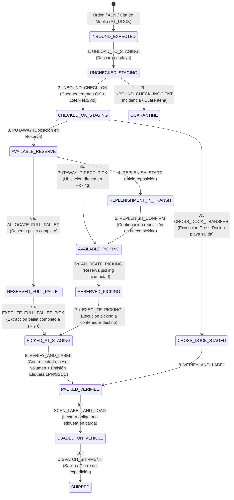

# Investigación Profunda de Sistemas de Gestión de Almacenes (WMS/SGA) para FORNEXA

- **TASK_ID:** `WMS-RESEARCH-20261017` (Fase 1 de 5)
- **Fecha de corte:** 17 de octubre de 2026 (`Europe/Madrid`)
- **Base de repositorio:** `91edc0e` (`origin/main`, tras integración de PR #113)
- **Autor de investigación (Fase 1):** Gemini (`GeminiFornexa`)
- **Coordinación:** Claude (`FornexaClaude`) · **Auditoría independiente:** FornexaGPT (`FORNEXA-WMS-AUDIT-20261017`)
- **Consumidor de Fase 2 (Propuesta de Arquitectura e Implantación):** DeepSeek

> [!IMPORTANT]
> **Alcance y Frontera de Fase 1 (Solo Investigación):**
> Este documento constituye la base empírica y comparativa para diseñar el módulo operativo de **Almacenes (`/dashboard/almacenes`)** de FORNEXA. Conforme al protocolo de separación de funciones entre fases, este entregable **no toma decisiones cerradas de implementación ni modifica código o esquema**: sistematiza cómo resuelven cada problema los WMS de referencia, define el catálogo completo de parámetros configurables, formaliza las precondiciones/postcondiciones y rechazos de cada tipo de movimiento (que servirán de oráculo en las pruebas E2E de Fase 5) y expone las **opciones de diseño con sus trade-offs** para que DeepSeek articule la propuesta técnica en la Fase 2.

---

## 0. Punto de Partida Real en FORNEXA (Esquema vs. Superficie Operativa)

Antes de comparar el mercado, es imprescindible distinguir entre **tablas físicas existentes en PostgreSQL/Supabase** (creadas en `20261002233000_master_data_foundation.sql` y `20261014090324_muelles_v1_core.sql`, y pobladas con 150 filas sintéticas en `DATA150` + 2.031 filas en `MUELLES-SEED`) y **capacidades realmente conectadas a rutas de API o pantallas**:

### 0.1. Lo que existe hoy en Base de Datos (`public`)
1. **`warehouses`**: `id`, `tenant_id`, `code`, `name`, `owner_party_id`, `address_id`, `status`, `capabilities (jsonb)`.
2. **`warehouse_zones`**: `id`, `tenant_id`, `warehouse_id`, `zone_code`, `zone_name`, `zone_type` (`RECEIVING`, `STORAGE`, `PICKING`, `STAGING`, `SHIPPING`, `QUARANTINE`, `RETURNS`, `CROSS_DOCK`), `temperature_regime`, `is_active`.
3. **`warehouse_bins`**: `id`, `tenant_id`, `warehouse_id`, `zone_id`, `bin_code`, `aisle`, `rack`, `shelf`, `bin_position`, `bin_type` (`PALLET`, `SHELF`, `FLOOR`, `DOCK`, `STAGING`, `BULK`), `max_weight_kg`, `max_volume_m3`, `max_pallets`, `is_blocked`, `is_active`.
4. **`inventory_quants`**: `id`, `tenant_id`, `warehouse_id`, `bin_id`, `product_id`, `owner_party_id`, `batch_number`, `serial_number`, `expiry_date`, `quantity_on_hand`, `quantity_reserved`, `uom`, `stock_status` (`AVAILABLE`, `RESERVED`, `QUARANTINE`, `DAMAGED`, `BLOCKED`), `last_counted_at`.
5. **`inventory_movements`**: `id`, `tenant_id`, `warehouse_id`, `movement_number`, `movement_type` (`RECEIPT`, `PUTAWAY`, `REPLENISHMENT`, `PICKING`, `TRANSFER`, `ADJUSTMENT`, `SHIPMENT`, `RETURN`), `product_id`, `source_bin_id`, `destination_bin_id`, `quantity`, `uom`, `owner_party_id`, `batch_number`, `serial_number`, `reference_order_id`, `reference_delivery_note_id`, `operator_id (text)`, `requested_at`, `started_at`, `completed_at`, `duration_seconds` (calculado por trigger `trg_inventory_movements_duration`), `status` (`PENDING`, `IN_PROGRESS`, `COMPLETED`, `CANCELLED`), `notes`.
6. **Catálogo y Unidades (`products`, `product_packagings`, `uom_definitions`, `uom_conversions`)**: `sku`, `gtin`, `uom_base`, pesos/dimensiones/volumen, `is_hazardous`, `is_temperature_controlled`, `temp_min_c`, `temp_max_c`, `shelf_life_days`, `is_batch_managed`, `is_serial_managed`, `owner_party_id`, y jerarquía de empaquetado (`PACKAGE`, `BOX`, `PALLET`, etc.).
7. **Muelles, Citas y Eventos de Patio (`warehouse_docks`, `dock_appointments`, `dock_policies`, `dock_appointment_rules`, `transport_events`)**: Módulo **vivo en producción** (`/dashboard/muelles` y `/muelles/p/[token]`) con citas enlazadas a `trip_stops`, `orders` y `expeditions`, y eventos `DOCK_GATE_IN`, `DOCK_CHECK_IN`, `DOCK_OPERATION_START`, `DOCK_OPERATION_END`, `DOCK_CHECK_OUT`.

### 0.2. Lo que existe hoy en API y UI (y lo que NO existe)
- **Existe lectura parcial:** `lib/traceability-loader.ts` consulta en modo solo-lectura `warehouses`, `warehouse_bins`, `inventory_quants` e `inventory_movements` para reconstruir la línea temporal de un artículo en `/dashboard/trazabilidad`. Asimismo, `lib/dock-loader.ts` lee `warehouses` y `warehouse_zones` para Muelles.
- **No existe pantalla ni API de Almacenes (WMS):** `/dashboard/almacenes` cae en el shell genérico `app/dashboard/[module]/page.tsx`, donde figura en `unfinishedModules` («Módulo en construcción»). No existe ningún endpoint en `app/api/` que lea o escriba ubicaciones, stock, recepciones, ubicaciones (putaway), reposiciones, picking, etiquetas LPN/SSCC ni cargas de almacén.
- **Huecos estructurales en el modelo actual que deben cubrirse para soportar múltiples tipologías de cliente:**
  1. **Ausencia de configuración de comportamiento (Behavior Policy):** No existe tabla de reglas operativas por almacén ni por depositante (`owner_party_id`) ni por familia de producto (ej. captura de lote en entrada/salida, FIFO/FEFO/LIFO, consolidación de reposiciones, mezcla de lotes/SKUs en hueco, obligatoriedad de control de peso/volumen/etiqueta en carga).
  2. **Ausencia de Unidad de Manipulación / Contenedor Logístico (LPN / Handling Unit / SSCC):** `inventory_quants` y `inventory_movements` rastrean `product_id + bin_id + batch_number`, pero carecen de entidad `handling_unit` / `lpn_code` / `sscc`. Sin LPN no se puede representar rigurosamente un «pallet en playa pendiente de chequear», un «pallet almacenado completo», un «pallet multi-referencia consolidado» ni la «lectura obligatoria de etiqueta de pallet/bulto al cargar el camión».
  3. **Ausencia de Recursos de Almacén (Operarios tipados, Carretillas/MHE y Equipos Automáticos):** `inventory_movements.operator_id` es una columna `text` libre; no existen entidades para recursos humanos (turnos, zonas asignadas, certificaciones de carretilla/ADR) ni medios mecánicos/automáticos (transpaleta, retráctil, trilateral, transelevador AS/RS, AGV) ni restricciones de compatibilidad recurso–zona–altura–peso.
  4. **Ausencia de Reglas de Reposición y Capacidad de Picking (`min/max` por hueco/artículo):** `warehouse_bins` tiene capacidad física máxima (`max_weight_kg`, `max_volume_m3`, `max_pallets`), pero no define qué SKU tiene asignado un hueco de picking fijo/dinámico ni sus umbrales `min_qty`, `max_qty` y `replenishment_uom`.
  5. **Ausencia de Reservas por Línea / Asignación Estricta (`stock_reservations` / `allocations`):** `inventory_quants.quantity_reserved` es un escalar agregado sin desglose de qué orden, ola, tarea o movimiento mantiene bloqueado ese stock, lo que impide liberar reservas selectivamente o auditar contención.
  6. **Ausencia de Cola de Tareas y Olas (`warehouse_tasks` / `waves`) y Checklists de Recepción/Carga:** Aunque `inventory_movements` tiene estados `PENDING → IN_PROGRESS → COMPLETED`, falta modelar el documento de recepción/descarga (vinculado a la cita de muelle `dock_appointment_id`), el estado de chequeo físico/calidad en playa, la emisión/impresión de etiqueta GS1/LPN y la verificación de etiqueta/peso/volumen previa a la carga.

---

## 1. Sistemas de Referencia Analizados y Verificación de «Whales»

Se han contrastado diez sistemas consolidados del mercado global y europeo:

1. **Mecalux Easy WMS** (España / Global): SGA líder en integración nativa con almacenes tanto convencionales como automatizados (transelevadores AS/RS, Pallet Shuttle, AGVs) a través de su capa WCS (*Easy WCS*) y módulos especializados (*Multi Carrier*, *Labor Management*, *Slotting*, *3PL Billing*).
2. **WHALES WMS / SGA — TLSI** (España — **Verificación de la referencia «whales» citada por Fran**):
   - **Identificación verificada:** Corresponde a **WHALES** (*Warehouse Handling Application Logistics Engineering System*), el Sistema de Gestión de Almacenes (SGA/WMS) desarrollado por la ingeniería española **TLSI** (*Tecnología, Logística y Sistemas Integrados*, `tlsi.es`).
   - **Enfoque diferencial:** Sistema modular muy implantado en operativa industrial, distribución y 3PL en España. Destaca por parametrizar el almacén mediante **mapas lógicos de zonas/ubicaciones**, guiado estricto de operarios por radiofrecuencia (RF) sin decisión improvisada en pasillo, control en tiempo real de **playas de recepción y expedición**, trazabilidad total de lotes/matriculación de palets y enlace directo entre producción, almacén y expedición/transporte.
3. **Manhattan Active Warehouse Management** (EE. UU. / Global): Referencia Tier-1 cloud-native basada en microservicios con motor unificado de *Order Streaming* (combina ejecución por olas *wave* y sin olas *waveless*), *Task Interleaving* (entrelazado de tareas) y optimización algorítmica de *slotting* y reposición.
4. **SAP EWM (Extended Warehouse Management — S/4HANA)** (Alemania / Global): Estándar industrial para manufactura compleja, química/ADR y gran distribución. Modela todo movimiento físico o lógico mediante *Warehouse Orders (WO)*, *Warehouse Tasks (WT)*, *Handling Units (HU / SSCC)*, *Storage Type Search Sequences* y *Stock Types* (`F1` libre en picking, `F2` libre en reserva, `Q` calidad, `B` bloqueado).
5. **Odoo Inventory / WMS (`addons/stock`)** (Bélgica / Open Source): Referencia clave por su modelo relacional abierto y auditable en PostgreSQL (`stock.location` jerárquico, `stock.quant`, `stock.move`, `stock.move.line`, `stock.lot`, `stock.quant.package` para LPN/pallets, `stock.Location.removal_strategy` y `stock.warehouse.orderpoint` para reposiciones).
6. **Microsoft Dynamics 365 Supply Chain Management (Advanced WMS)**: Separa declarativamente el **«Dónde»** (*Location Directives* con estrategias `Consolidate`, `FEFO batch reservation`, `Match packing quantity`, `Empty location with no incoming work`) del **«Cómo/Qué»** (*Work Templates* que descomponen cada operación en pares `Pick → Put` con paradas intermedias en `Stage` / `Baydoor`).
7. **Blue Yonder WMS (antes JDA / RedPrairie)** y **Körber One WMS (HighJump)** / **Infor WMS**: Referencias en 3PL multi-cliente (*Multi-Tenant / Multi-Owner*) con reglas de facturación logística, alocación configurable por depositante y motores de reglas dirigidas por eventos.
8. **Suites Europeas 3PL y Automatización — Reflex WMS (Hardis Group), Generix WMS y WAMAS (SSI Schäfer)**: Referencias europeas en distribución multicanal, gran consumo (FMCG), frío y control de mecanización/AS/RS.

---

## 2. Matriz de Capacidades WMS (Mercado vs. Alcance para FORNEXA)

La siguiente matriz cruza los 9 ejes funcionales exigidos con la solución adoptada por las referencias líderes y clasifica cada capacidad para FORNEXA en **Núcleo (Fase 3 — MVP Productivo)**, **Fase Posterior (Evolución)** o **Fuera de Alcance actual**, justificando el porqué:

| Eje / Capacidad | Qué significa operativamente | Cómo lo resuelven los referentes (EasyWMS, WHALES, Manhattan, SAP EWM, Odoo, D365) | Clasificación FORNEXA | Justificación y vínculo con el dominio actual |
| :--- | :--- | :--- | :---: | :--- |
| **1.1 Zonas Lógicas y Mapa Físico (`Aisle-Rack-Shelf-Bin`)** | Dividir el almacén en áreas con función y régimen térmico homogéneos, y direccionar cada hueco con coordenadas ordenables (`serpiente` o `peine`) para minimizar recorrido. | **EasyWMS / WHALES:** Mapa 2D/3D de zonas (`Recepción`, `Playa Entrada`, `Pulmón/Reserva`, `Picking`, `Playa Salida`, `Cuarentena`, `Devoluciones`, `Cross-Dock`) + secuencia de recorrido (`walk_sequence`). **SAP EWM:** *Storage Types* + *Storage Sections* + *Storage Bins* con indicadores de peso, volumen, altura y clase de fuego/ADR. | **NÚCLEO** | `warehouse_zones` y `warehouse_bins` ya existen en BD. Solo requieren conectar API/UI y enriquecer atributos de picking/secuencia y restricciones operativas. |
| **1.2 Tipologías de Estantería y Comportamiento de Hueco** | Modelar estantería convencional, *drive-in* (LIFO por calle), *push-back*, dinámica (*flow rack* FIFO), suelo en bloque, entreplanta o cámara frigorífica. | **SAP EWM / Reflex:** El tipo de ubicación dicta si admite acceso selectivo a cualquier pallet o solo al frontal/último. **D365:** *Location Profiles* controlan si el hueco rastrea LPN, si permite mezcla de SKU/lote y cómo computa capacidad (pallets vs. volumen/peso). | **NÚCLEO** | Parametrizable sobre `warehouse_bins` (`bin_type` + perfil de comportamiento) sin requerir hardware externo. |
| **2.1 Recursos: Operarios, Carretillas y Automatismos** | Tipificar quién y con qué equipo puede ejecutar un movimiento según altura, peso, zona y certificaciones (carnet retráctil, ADR, frío). | **EasyWMS / Manhattan:** Matriz de recursos (`Operario` + `Equipo MHE`: transpaleta manual/eléctrica, retráctil, trilateral, recogepedidos, transelevador AS/RS, AGV). Una tarea de nivel 5 (`>6 m`) o pallet de `1.200 kg` o zona `ADR` solo se asigna a recurso compatible. **SAP EWM:** *Resource Types* y *Queue Determination* (`RF Queue` vs `MFS Queue` para PLC/transelevador). | **NÚCLEO (Modelo y Asignación)** *Fase Posterior (Telemetría PLC/WCS en vivo)* | Fran pide explícitamente recursos (carretillas, operarios, almacenes automáticos). El núcleo debe sustituir `operator_id (text)` por un catálogo real de recursos (`OPERATOR`, `FORKLIFT`, `REACH_TRUCK`, `ORDER_PICKER`, `ASRS_CRANE`, `AGV_SHUTTLE`) con estado y restricciones. La conexión física TCP/OPC-UA con PLCs queda para Fase Posterior. |
| **3.1 Identidad del Stock y Matrícula de Pallet (LPN / SSCC)** | Identificar cada unidad logística (pallet, contenedor, caja máster) con un código único (`LPN` interno o `SSCC` GS1-18 dígitos) que agrupa uno o varios lotes/SKUs y viaja desde la descarga hasta la carga. | **EasyWMS / WHALES / Manhattan / SAP EWM:** Todo pallet recibido en playa recibe una matrícula (`LPN` / *Handling Unit*). Mover el LPN mueve atómicamente su contenido. En preparación se genera un LPN de destino (*Pick-to-LPN* / *Pallet de expedición*) cuya etiqueta debe leerse al cargar. **Odoo:** `stock.quant.package` (`package_id` en `stock.quant` y `result_package_id` en `stock.move.line`). | **NÚCLEO** | **Imprescindible** para cumplir los escenarios pedidos por Fran: *«pallets en playa chequeados y sin chequear, pallets almacenados, preparaciones de pallet completo, expediciones pendientes de leer etiqueta en carga»*. |
| **3.2 Jerarquía UOM y Empaquetado (`Unidad → Caja → Capa → Pallet`)** | Convertir y redondear cantidades entre unidad base (`EA`/`UN`), caja (`BOX`), capa (`LAYER`) y pallet (`PALLET`), desglosando un pedido en *Pallets Completos* (desde reserva) y *Cajas/Unidades sueltas* (desde picking). | **Manhattan / D365 / SAP EWM:** *Unit Sequence Groups* / *Packaging Specifications*. Al alocar una línea de pedido de 260 unidades (donde 1 Pallet = 100 UN y 1 Caja = 10 UN), el motor genera 2 tareas de *Full Pallet Pick* desde Reserva y 1 tarea de *Case/Unit Pick* (60 UN) desde Picking. | **NÚCLEO** | Ya tenemos `uom_definitions`, `uom_conversions` y `product_packagings` en BD; deben conectarse al motor de movimientos y picking. |
| **4.1 Estados de Stock y Máquina de Calidad/Playa** | Distinguir físicamente y lógicamente qué stock puede reservarse para pedidos y cuál no. | **SAP EWM / EasyWMS / WHALES:** Estados separados para: `UNCHECKED_STAGING` (descargado en muelle/playa sin verificar), `CHECKED_OK_STAGING` (chequeado OK en playa, pendiente de ubicar), `AVAILABLE` (en ubicación definitiva y apto para reserva/picking), `RESERVED` (comprometido a orden/ola/reposición), `PICKED_STAGED` (preparado y etiquetado en playa de salida), `LOADED` (cargado en vehículo tras lectura de etiqueta), `QUARANTINE`, `DAMAGED`, `BLOCKED`. | **NÚCLEO** | Resuelve directamente la regla de oro de Fran: **jamás permitir picking sobre stock no ubicado o no chequeado OK en recepción** (salvo flujo explícito de Cross-Docking tras chequeo OK). |
| **5.1 Estrategias de Entrada (Recepción, Chequeo y Putaway Dirigido)** | Guiar la descarga desde el muelle (`dock_appointments`), exigir o no captura de lote/caducidad, realizar chequeo de conformidad y proponer ubicación óptima de almacenaje. | **EasyWMS / D365 / Odoo:** Reglas de *Putaway*: 1) Ubicación fija por SKU, 2) Consolidación con el mismo SKU+lote ya existente, 3) Zona por temperatura (`FROZEN`/`CHILLED`/`AMBIENT`) y peligrosidad (`ADR`), 4) Rotación ABC (A cerca de muelle/cota baja), 5) Hueco vacío respetando peso/volumen/pallets máximos. | **NÚCLEO** | Enlaza nativamente nuestro módulo **Muelles** (`dock_appointments` en estado `AT_DOCK`) con el inicio del flujo de **Almacenes**. |
| **5.2 Estrategias de Salida (`FIFO / LIFO / FEFO / LEFO`) y Captura de Lote** | Determinar qué lote/quant debe extraerse y si el operario debe escanear/confirmar el lote en entrada y/o en salida. | **SAP EWM / D365 / EasyWMS:** Regla configurable por almacén/depositante/producto: `FEFO` (prioriza menor `expiry_date` descartando lotes con vida útil remanente inferior al mínimo del cliente), `FIFO` (menor fecha de entrada/recepción), `LIFO` (última entrada, típico en estanterías *drive-in* o graneles), `MANUAL`. | **NÚCLEO** | Requisito explícito de Fran (*«capturar o no lote a la entrada; capturar o no lote a la salida; guardar/extraer según FIFO, LIFO, FEFO»*). |
| **5.3 Reposición a Picking y Consolidación (`SÍ / NO / POR_LOTE`)** | Reabastecer huecos de picking desde zona de reserva (por umbral `min/max` o por demanda de ola pendiente) y decidir cómo agrupar las tareas/cantidades de reposición. | **EasyWMS / Manhattan / D365:** Tres modos de consolidación de reposiciones: • **`NO` (Discreta 1:1):** Cada disparo o pedido genera un movimiento de reposición independiente. • **`YES` (Consolidada por SKU+Hueco destino):** Suma necesidades de múltiples pedidos/disparos del mismo SKU hacia el mismo hueco de picking hasta completar la capacidad máxima del hueco (`max_qty`) o del pallet, admitiendo mezclar lotes si el hueco lo permite. • **`BY_BATCH` (Consolidada estrictamente por SKU + Lote):** Agrupa y suma necesidades de reposición únicamente cuando comparten el mismo `product_id` y `batch_number`, evitando mezclar lotes distintos en la tarea o en el hueco de picking. | **NÚCLEO** | Requisito explícito de Fran (*«consolidación de las reposiciones de picking sí o no, o según lote»*). |
| **5.4 Preparación (Picking de Unidad/Caja vs. Pallet Completo), Etiquetado y Carga** | Ejecutar extracción de mercancía, generar etiqueta logística del bulto/pallet preparado, auditar estado/peso/volumen y exigir lectura de etiqueta en puerta de muelle antes de dar por cargado el viaje/expedición. | **WHALES / EasyWMS / Manhattan:** La preparación cierra el contenedor (`LPN/SSCC`), verifica peso/volumen contra tolerancia teórica o báscula, emite etiqueta (`LABEL_ISSUED`) y deposita el LPN en playa de expedición (`SHIPPING_STAGE`). El proceso de **Carga (`LOAD`)** en el muelle rechaza cualquier LPN cuya etiqueta no haya sido emitida, que no esté en estado `STAGE_READY` o que carezca de validación de estado/peso/volumen. | **NÚCLEO** | Requisito explícito de Fran para validación punto a punto en producción. |
| **6.1 Motor de Propuestas y Optimización Masiva (Miles de líneas/día)** | Evaluar miles de líneas de pedido, stock y huecos para generar propuestas óptimas de ubicación (*putaway*), reposición, olas de picking y *slotting* sin bloquear la transaccionalidad OLTP. | **Manhattan Active / SAP EWM / EasyWMS:** Separación estricta entre el **Motor de Planificación/Propuestas** (que calcula en lote olas, asignaciones óptimas, rutas de pasillo y reposiciones sugeridas) y el **Motor de Ejecución Transaccional** (que confirma cada movimiento con bloqueo pesimista `FOR UPDATE` e invariantes ACID). | **NÚCLEO (Arquitectura desacoplada Propuesta vs. Ejecución)** | Ver análisis detallado de rendimiento y rol de Python vs. PostgreSQL/Node en la **Sección 5**. |
| **7.1 Multi-propietario (3PL) y Facturación Logística (3PL Billing)** | Permitir que un mismo almacén opere mercancía de múltiples clientes depositantes (`owner_party_id`) con reglas operativas propias por cliente, y liquidar eventos de almacenaje/manipulación. | **Blue Yonder / EasyWMS 3PL / Reflex:** Las políticas de almacén admiten *override* por `owner_party_id` (ej. Cliente Farma exige FEFO + captura de lote entrada/salida + cuarentena obligatoria; Cliente Construcción en el mismo almacén usa FIFO sin lote). | **NÚCLEO (Políticas por Almacén + Override por Depositante)** *Fase Posterior (Facturación 3PL automática vinculada a Tarifas)* | Las tablas actuales ya incluyen `owner_party_id` en `warehouses`, `inventory_quants`, `inventory_movements` y `products`. |

---

## 3. Catálogo Exhaustivo de Parámetros de Comportamiento (`WMS Behavior Policies`)

En los sistemas de referencia (SAP EWM *Storage Type / Process Controls*, Dynamics 365 *Location Directives & Warehouse Parameters*, EasyWMS *Reglas de Negocio*, WHALES *Parámetros de Operativa*), el comportamiento del almacén no se codifica con `if` fijos, sino mediante una **jerarquía de configuración en cascada**:

$$\text{Regla Efectiva} = \text{Override Producto/Familia} \;\triangleright\; \text{Override Depositante (owner\_party\_id)} \;\triangleright\; \text{Política del Almacén (warehouse\_id)} \;\triangleright\; \text{Default del Tenant}$$

A continuación se detalla el catálogo de **22 parámetros canónicos de comportamiento**, especificando su dominio de valores, su valor por defecto seguro, el nivel jerárquico donde se aplica y **qué invariantes se rompen o qué precauciones exige cambiarlo en caliente** (con stock u operaciones en curso):

| Código de Parámetro | Nombre Funcional | Dominio de Valores | Valor por Defecto | Nivel de Configuración | Impacto y Riesgo de Cambio en Caliente (*Hot-Change Hazard*) |
| :--- | :--- | :--- | :--- | :--- | :--- |
| **`inbound_batch_capture_mode`** | Captura de lote en recepción/entrada | `REQUIRED` \| `OPTIONAL` \| `DISABLED` \| `BY_PRODUCT_FLAG` | `BY_PRODUCT_FLAG` (exige lote si `products.is_batch_managed = true`) | Almacén / Depositante / Producto | **Alto:** Pasar de `DISABLED` a `REQUIRED` con recepciones abiertas en playa sin lote bloquea su confirmación de chequeo/ubicación hasta asignar un lote de regularización. |
| **`outbound_batch_capture_mode`** | Captura/confirmación de lote en picking y salida | `REQUIRED_SCAN` (escanear lote exacto asignado o válido) \| `AUTO_ALLOCATED` (propuesto por motor sin re-escaneo) \| `DISABLED` | `REQUIRED_SCAN` para gestionados por lote | Almacén / Depositante / Producto | **Medio:** Cambiar a `REQUIRED_SCAN` con quants antiguos en ubicaciones de picking que tienen `batch_number IS NULL` impedirá confirmar el picking hasta regularizar el lote del quant. |
| **`inbound_expiry_capture_mode`** | Captura de fecha de caducidad en entrada | `REQUIRED_IF_SHELF_LIFE` \| `ALWAYS_REQUIRED` \| `OPTIONAL` \| `DISABLED` | `REQUIRED_IF_SHELF_LIFE` (`shelf_life_days > 0`) | Almacén / Depositante / Producto | **Alto:** Si se activa `FEFO` como regla de rotación, cualquier quant entrante sin `expiry_date` queda excluido de la ordenación FEFO o degradado a FIFO. |
| **`stock_rotation_policy`** | Estrategia de rotación y extracción de stock | `FIFO` (First-In, First-Out) \| `FEFO` (First-Expired, First-Out) \| `LIFO` (Last-In, First-Out) \| `LEFO` \| `STRICT_BATCH` | `FEFO` (si tiene caducidad) / `FIFO` (resto) | Almacén / Depositante / Familia / Zona | **Medio:** Cambiar de `FIFO` a `FEFO` en caliente altera el orden de las próximas reservas/olas, pero **no debe invalidar** reservas ya comprometidas en tareas `IN_PROGRESS`. |
| **`fefo_min_remaining_shelf_life_days`** | Vida útil mínima remanente al expedir | Entero `>= 0` (días) | `0` (`30` en alimentación/farma) | Depositante / Producto | **Bajo:** Reduce inmediatamente el stock elegible para nuevos pedidos; los lotes por debajo del umbral pasan lógicamente a no asignables para venta estándar. |
| **`replenishment_trigger_mode`** | Modo de disparo de reposiciones a picking | `MIN_MAX_THRESHOLD` (bajo mínimo de hueco) \| `DEMAND_WAVE` (por demanda de pedidos pendientes) \| `HYBRID` \| `MANUAL` | `HYBRID` | Almacén / Zona de Picking | **Bajo:** Afecta únicamente a la generación de nuevas propuestas de reposición. |
| **`replenishment_consolidation_mode`** | **Consolidación de reposiciones de picking** *(pedido expresamente por Fran)* | `NO` (1 tarea por necesidad) \| `YES` (agrupa por `product_id + destination_bin_id` hasta `max_qty`) \| `BY_BATCH` (agrupa solo si coinciden `product_id + destination_bin_id + batch_number`) | `BY_BATCH` | Almacén / Depositante / Zona | **Crítico con `allow_mixed_batches_in_bin`:** Si se activa `YES` (sin segregar por lote), una reposición consolidada puede volcar dos lotes distintos en el mismo hueco de picking. Por tanto, `YES` exige que el hueco destino permita mezcla de lotes o que se consolide por contenedor origen del mismo lote. |
| **`allow_picking_from_unconfirmed_receipt`** | Permitir picking sobre mercancía recibida no chequeada OK o no ubicada | `false` (estricto: solo stock `AVAILABLE` en ubicación) \| `CROSS_DOCK_CHECKED_ONLY` (solo en flujo Cross-Dock tras chequeo OK) | `false` | Almacén (Invariante de seguridad) | **Crítico (Invariante de Fran):** Nunca puede ser `true` para stock sin chequear (`UNCHECKED_STAGING`). El backend debe rechazar (`409 Conflict` / `422`) todo intento de reserva o picking sobre stock no confirmado OK o pendiente de putaway. |
| **`putaway_strategy`** | Estrategia de propuesta de ubicación en entrada | `FIXED_BIN_FIRST` \| `CONSOLIDATE_BATCH` \| `DIRECTED_ABC_ZONE` \| `NEAREST_EMPTY` \| `CHAOTIC` | `DIRECTED_ABC_ZONE` | Almacén / Zona | **Bajo:** Solo afecta al motor de cálculo de propuestas para nuevos *putaways*. |
| **`allow_mixed_skus_in_bin`** | Permitir múltiples artículos (SKUs) en un mismo hueco | `true` \| `false` (`true` siempre en playas `STAGING`/`DOCK`) | `false` en `PALLET` reserva; `true` en `SHELF`/`STAGING` | Almacén / Tipo de Ubicación (`bin_type`) | **Alto:** Pasar de `true` a `false` cuando ya existen huecos con >1 SKU no debe corromper lecturas; debe bloquear *nuevas* entradas de un segundo SKU distinto a ese hueco. |
| **`allow_mixed_batches_in_bin`** | Permitir múltiples lotes del mismo SKU en un mismo hueco | `true` \| `false` | `false` en `PALLET` reserva; `true` en `PICKING` (o `false` en farma) | Almacén / Depositante / Tipo de Ubicación | **Alto:** Si pasa a `false`, el motor de *putaway* y el de reposición (`replenishment_consolidation_mode = BY_BATCH`) deben rechazar ubicar un lote $B_2$ en un hueco que aún conserve saldo $>0$ del lote $B_1$. |
| **`allow_negative_stock`** | Permitir saldo físico o disponible negativo en `inventory_quants` | `false` (prohibido siempre en producción) | `false` (Invariante dura de BD `CHECK (quantity_on_hand >= 0)`) | Instalación (Fijo en `false`) | **Invariante innegociable:** En un WMS real el stock físico jamás puede ser negativo; cualquier descuadre genera tarea de conteo/regularización o corto de picking (*short pick*). |
| **`require_reception_check_before_putaway`** | Exigir chequeo físico/calidad en playa antes de ubicar en estantería | `true` \| `false` | `true` | Almacén / Depositante | **Alto:** Garantiza el estado intermedio *«pallets en playa sin chequear → pallets en playa chequeados OK → ubicación»* requerido por Fran. |
| **`require_quarantine_on_receipt`** | Enviar entradas a estado `QUARANTINE` hasta liberación de calidad | `NEVER` \| `BY_PRODUCT_FLAG` \| `ALWAYS` | `BY_PRODUCT_FLAG` | Depositante / Producto | **Medio:** El stock entra con `stock_status = 'QUARANTINE'` y no es reservable para pedidos hasta ejecutar movimiento lógico `QUALITY_RELEASE`. |
| **`require_lpn_on_storage`** | Exigir matrícula de pallet/contenedor (`LPN/SSCC`) en almacenaje y playa | `REQUIRED_PALLET_AND_STAGE` \| `REQUIRED_ALL` \| `OPTIONAL` | `REQUIRED_PALLET_AND_STAGE` | Almacén / Zona | **Alto:** Permite distinguir e identificar unívocamente cada pallet en muelle, playa, estantería de reserva y carga. |
| **`full_pallet_split_policy`** | Separación automática de pedido en *Pallet Completo* vs. *Picking Fraccionado* | `SPLIT_FULL_PALLET_TO_RESERVE` \| `ALL_FROM_PICKING` | `SPLIT_FULL_PALLET_TO_RESERVE` | Almacén / Depositante | **Medio:** Cuando una línea de pedido iguala o supera 1 pallet (`product_packagings`), extrae el pallet completo directamente de Reserva sin pasar por el hueco de picking unitario. |
| **`require_label_before_load`** | Exigir emisión de etiqueta de expedición (`LPN/SSCC`) antes de cargar | `true` \| `false` | `true` | Almacén (Invariante de Fran) | **Crítico (Invariante de Fran):** Si es `true`, el endpoint de carga rechaza cualquier unidad de manipulación o línea cuya etiqueta de expedición no haya sido emitida (`label_status = 'ISSUED'`). |
| **`require_label_scan_on_load`** | Exigir lectura/escaneo de código de etiqueta en muelle al cargar | `true` \| `false` | `true` | Almacén | **Crítico (Invariante de Fran):** Impide cerrar la carga de una expedición si quedan bultos/pallets en estado `PENDING_LOAD_SCAN`. |
| **`require_weight_volume_check_before_load`** | Exigir control de estado, peso y volumen antes de autorizar la carga | `STRICT_ALL` (estado OK + peso > 0 + volumen > 0 validados) \| `STATE_ONLY` \| `OPTIONAL` | `STRICT_ALL` | Almacén / Depositante | **Crítico (Invariante de Fran):** *«no se puede cargar un material que no se haya lanzado etiqueta, controlado estado, volumen, peso»*. |
| **`movement_confirmation_mode`** | Confirmación de movimientos en un paso vs. dos pasos | `TWO_STEP` (`PENDING → IN_PROGRESS → COMPLETED` con lectura de origen y destino) \| `ONE_STEP_IMMEDIATE` | `TWO_STEP` (operativa RF/patio); `ONE_STEP_IMMEDIATE` solo en ajustes de supervisor | Almacén / Tipo de Movimiento | **Medio:** En dos pasos, el stock en tránsito entre origen y destino permanece bloqueado/comprometido para evitar doble consumo. |
| **`cycle_count_discrepancy_tolerance_pct`** | Tolerancia porcentual para aprobar automáticamente un recuento cíclico | Decimal `0.00` a `100.00` (`%`) | `2.00%` (superado el umbral exige aprobación de `OWNER`/`ADMIN`) | Almacén / Depositante | **Bajo:** Protege contra ajustes masivos accidentales de inventario por error de tecleo del operario. |
| **`task_interleaving_enabled`** | Entrelazado de tareas (combinar un viaje de *Putaway* con uno de *Reposición/Full Pallet Pick* al volver) | `true` \| `false` | `true` (en motor de propuestas) | Almacén | **Bajo:** Optimiza recorridos de carretilla reduciendo viajes en vacío. |

---

## 4. Catálogo de Tipos de Movimiento, Máquina de Estados e Invariantes de Rechazo

Esta sección define el contrato formal de **14 operaciones/movimientos de almacén**. Cada movimiento especifica su estado inicial, sus **precondiciones estrictas**, sus **postcondiciones atómicas** y los **casos de rechazo obligatorio en backend** que se probarán punto a punto en producción en la Fase 5.

### 4.1. Ciclo de Vida de una Unidad de Stock / LPN a través del Almacén

### 4.2. Tabla Formal de Movimientos: Precondiciones, Postcondiciones y Rechazos Backend

| # | Código de Movimiento (`movement_type` / Acción) | Origen → Destino | Precondiciones Estrictas (Invariantes de Entrada) | Postcondiciones Atómicas (Efectos en BD) | Rechazos Obligatorios en Backend (Oráculo para Tests E2E de Fase 5) |
| :-: | :--- | :--- | :--- | :--- | :--- |
| **M1** | **`UNLOAD_TO_STAGING`** *(Descarga de camión a playa de recepción)* | Muelle (`DOCK`) → Playa Recepción (`RECEIVING` / `STAGING`) | 1. Cita de muelle (`dock_appointments`) en estado `CHECKED_IN` o `AT_DOCK`, o recepción autorizada. 2. Ubicación destino activa (`is_active=true`, `is_blocked=false`) de zona `RECEIVING`/`STAGING`. 3. Cantidad $> 0$. | 1. Crea/actualiza LPN en playa con estado **`UNCHECKED_STAGING`** (`stock_status = 'QUARANTINE'` o estado de chequeo `PENDING_CHECK`). 2. Registra movimiento `RECEIPT` (`IN_PROGRESS` o `COMPLETED` en playa). 3. **El stock NO es reservable ni apto para picking (`reservable = false`).** | • Rechazar (`409`) si el hueco de playa está bloqueado o en otro almacén/tenant. • Rechazar (`400`) si cantidad $\le 0$. |
| **M2** | **`INBOUND_CHECK`** *(Chequeo de recepción en playa: lote, caducidad, estado, bultos)* | Playa Recepción (`UNCHECKED_STAGING`) → Playa Recepción (`CHECKED_OK_STAGING` o `QUARANTINE`/`DAMAGED`) | 1. El LPN/quant existe en zona de recepción en estado `UNCHECKED_STAGING`. 2. Si `inbound_batch_capture_mode = REQUIRED` (o `BY_PRODUCT_FLAG` con `is_batch_managed=true`), **`batch_number` no vacío es obligatorio**. 3. Si `inbound_expiry_capture_mode` aplica, **`expiry_date` válida es obligatoria**. | 1. Si el chequeo es conforme (`OK`): marca el LPN/quant como **`CHECKED_OK_STAGING`** y genera automáticamente la tarea pendiente de ubicación (`PUTAWAY` `PENDING`). 2. Si hay daño o cuarentena: pasa a `DAMAGED` o `QUARANTINE` y genera tarea hacia zona `QUARANTINE`. 3. **Sigue sin poder hacerse picking estándar hasta completar `PUTAWAY` (salvo orden explícita de Cross-Dock).** | • **Rechazo E2E #1:** Intentar confirmar chequeo OK de un artículo gestionado por lote sin informar `batch_number` cuando la política exige captura de lote en entrada (`422 Unprocessable Entity`). • **Rechazo E2E #2:** Intentar confirmar chequeo OK sin `expiry_date` en producto perecedero con política activa (`422`). |
| **M3** | **`PUTAWAY`** *(Ubicación desde playa a estantería de almacenaje o picking)* | Playa Recepción (`CHECKED_OK_STAGING`) → Ubicación Almacenaje (`STORAGE` / `PICKING`) | 1. El LPN/quant origen está en `CHECKED_OK_STAGING` (nunca en `UNCHECKED_STAGING` si `require_reception_check_before_putaway = true`). 2. Ubicación destino activa, no bloqueada, compatible con régimen térmico (`FROZEN`/`CHILLED`/`AMBIENT`) y ADR (`is_hazardous`). 3. Respeta `max_weight_kg`, `max_volume_m3`, `max_pallets` del hueco destino. 4. Respeta `allow_mixed_skus_in_bin` y `allow_mixed_batches_in_bin`. 5. Recurso asignado (carretilla/operario) activo y compatible. | 1. Descuenta saldo de la playa de recepción y suma saldo en la ubicación destino con `stock_status = 'AVAILABLE'`. 2. Actualiza ubicación del LPN. 3. Marca movimiento `PUTAWAY` como `COMPLETED` registrando `completed_at` y `duration_seconds`. 4. **Solo a partir de este instante el stock pasa a ser elegible para reserva de picking o pallet completo.** | • **Rechazo E2E #3:** Intentar ubicar (`PUTAWAY`) un pallet que sigue en `UNCHECKED_STAGING` (sin chequeo de entrada OK) (`409 Conflict`). • **Rechazo E2E #4:** Intentar ubicar en un hueco que supera `max_weight_kg` / `max_pallets` o que ya contiene otro lote cuando `allow_mixed_batches_in_bin = false` (`409 Conflict`). • **Rechazo E2E #5:** Intentar ubicar producto refrigerado/congelado o ADR en zona incompatible (`422`). |
| **M4** | **`REPLENISHMENT_GENERATE_AND_CONFIRM`** *(Reposición de Reserva a Picking con consolidación `YES / NO / BY_BATCH`)* | Ubicación Reserva (`STORAGE`) → Ubicación Picking (`PICKING`) | 1. Stock origen en zona `STORAGE` con `stock_status = 'AVAILABLE'` y saldo libre (`quantity_on_hand - quantity_reserved >= qty`). 2. Selección del lote origen según política `stock_rotation_policy` (`FIFO` / `FEFO` / `LIFO`). 3. Aplicación de `replenishment_consolidation_mode`:   - `NO`: 1 movimiento por disparo.   - `YES`: consolida necesidades del mismo `product_id + destination_bin_id`.   - `BY_BATCH`: consolida necesidades solo si comparten `product_id + destination_bin_id + batch_number`. 4. Al confirmar, si el hueco destino tiene `allow_mixed_batches_in_bin = false`, el lote entrante debe coincidir con el lote existente en el hueco (o estar el hueco vacío). | 1. Al iniciar (`IN_PROGRESS`): compromete `quantity_reserved` en el hueco de reserva origen. 2. Al confirmar (`COMPLETED`): reduce `quantity_on_hand` y `quantity_reserved` en Reserva e incrementa `quantity_on_hand` (`AVAILABLE`) en el hueco de Picking destino. 3. Si hay órdenes esperando ese stock en picking, desbloquea su ejecución de picking. | • **Rechazo E2E #6 (Invariante de Fran):** Intentar ejecutar un picking fraccionado sobre un hueco de picking cuya reposición sigue en estado `PENDING` o `IN_PROGRESS` (no confirmada) y sin saldo disponible suficiente en el hueco de picking (`409 Conflict`). • **Rechazo E2E #7:** En modo `BY_BATCH`, rechazar la fusión de dos tareas de reposición con `batch_number` distinto (`409`). |
| **M5** | **`ALLOCATE_AND_PICK`** *(Preparación de Picking de unidades/cajas desde zona de Picking)* | Ubicación Picking (`PICKING`) → Contenedor/LPN de Preparación en Playa Salida (`STAGING` / `SHIPPING`) | 1. **Invariante crítica de Fran:** El stock origen DEBE estar en una ubicación de picking válida con `stock_status = 'AVAILABLE'` (recepción confirmada OK y ubicación/reposición ya confirmada). Jamás se puede hacer picking de `UNCHECKED_STAGING`, `CHECKED_OK_STAGING` (salvo Cross-Dock explícito), `QUARANTINE`, `DAMAGED` ni `BLOCKED`. 2. Cantidad solicitada $\le$ disponible real (`quantity_on_hand - quantity_reserved`). 3. Si `outbound_batch_capture_mode = REQUIRED_SCAN`, el operario debe enviar el `scanned_batch_number` y debe coincidir con el lote asignado por `FIFO`/`FEFO`/`LIFO` (o un lote equivalente con igual/menor caducidad si se permite sustitución). | 1. Al reservar: incrementa `quantity_reserved` y crea registro en `stock_reservations`. 2. Al confirmar picking: descuenta del hueco de picking y traslada la cantidad al LPN de expedición en playa de salida con estado **`PICKED_AT_STAGING`** (`label_status = 'PENDING'`, `load_check_status = 'PENDING'`). 3. Registra movimiento `PICKING` `COMPLETED` con operario, carretilla/recurso y tiempos. | • **Rechazo E2E #8 (Invariante de Fran):** Intentar preparar/confirmar picking de mercancía que aún está en descarga o en playa sin ubicar (`UNCHECKED_STAGING` / `CHECKED_OK_STAGING`) o cuya entrada no está confirmada OK (`409 Conflict`). • **Rechazo E2E #9:** Intentar confirmar salida/picking sin capturar `batch_number` (o escaneando un lote distinto al requerido por FEFO/FIFO) cuando `outbound_batch_capture_mode = REQUIRED_SCAN` (`422`). • **Rechazo E2E #10:** Intentar doble consumo concurrente del mismo quant por encima de `quantity_on_hand` (`409 Conflict` con bloqueo `FOR UPDATE`). |
| **M6** | **`FULL_PALLET_PICK`** *(Extracción de Pallet Completo desde Reserva a Playa de Expedición)* | Ubicación Reserva (`STORAGE`) → Playa Expedición (`STAGING` / `SHIPPING`) | 1. El LPN origen está en `STORAGE` con `stock_status = 'AVAILABLE'`, sin reservas ajenas, y su lote cumple la política `FIFO`/`FEFO`/`LIFO`. 2. Si `outbound_batch_capture_mode = REQUIRED_SCAN`, requiere confirmación de matrícula LPN y lote. | 1. Traslada el LPN completo desde la estantería de Reserva a la ubicación de Playa de Expedición en estado **`PICKED_AT_STAGING`**. 2. Registra movimiento `PICKING` (subtipo `FULL_PALLET`) `COMPLETED`. | • Rechazar (`409`) si el pallet está en `QUARANTINE`/`BLOCKED` o tiene parte de su saldo reservado para una reposición en curso. |
| **M7** | **`CROSS_DOCK_TRANSFER`** *(Excepción autorizada: paso directo de Recepción a Expedición sin estantería)* | Playa Recepción (`CHECKED_OK_STAGING`) → Playa Expedición (`CROSS_DOCK` / `SHIPPING`) | 1. Orden/línea marcada explícitamente para flujo `CROSS_DOCK`. 2. **El pallet DEBE haber superado primero el chequeo de entrada (`M2: INBOUND_CHECK` = `CHECKED_OK_STAGING`)** con captura de lote si aplica. 3. Prohibido incluso en Cross-Dock saltar el chequeo de recepción (`UNCHECKED_STAGING`). | 1. Mueve el LPN de la playa de recepción a la playa de expedición/cross-dock en estado `PICKED_AT_STAGING` (pendiente de etiquetado de salida y control de carga). 2. Registra movimiento `TRANSFER` (subtipo `CROSS_DOCK`). | • **Rechazo E2E #11:** Intentar Cross-Dock sobre un pallet en `UNCHECKED_STAGING` (sin haber confirmado OK la recepción) (`409 Conflict`). |
| **M8** | **`VERIFY_PACK_AND_ISSUE_LABEL`** *(Control pre-carga de estado, peso y volumen + Emisión de etiqueta logística LPN/SSCC)* | En Playa de Expedición (`PICKED_AT_STAGING` → `STAGE_READY_FOR_LOAD`) | 1. El LPN/bulto de expedición está completo en playa de salida (`PICKED_AT_STAGING`). 2. **Control explícito de estado físico (`condition_check_ok = true`), peso bruto verificado (`verified_weight_kg > 0`) y volumen verificado (`verified_volume_m3 > 0`).** 3. Generación de código único de etiqueta (`label_code` / `SSCC-18` con dígito de control GS1 mod-10). | 1. Actualiza el LPN de expedición con `verified_weight_kg`, `verified_volume_m3`, `condition_check_ok = true`, `label_code`, `label_issued_at` y pasa su estado a **`STAGE_READY_FOR_LOAD`**. | • **Rechazo E2E #12 (Invariante de Fran):** Intentar emitir etiqueta o dar por listo para carga un LPN con `condition_check_ok = false`, `verified_weight_kg <= 0` o `verified_volume_m3 <= 0` (`422 Unprocessable Entity`). |
| **M9** | **`SCAN_LABEL_AND_LOAD_SHIPMENT`** *(Lectura de etiqueta en muelle de carga y expedición final)* | Playa Expedición (`STAGE_READY_FOR_LOAD`) → Vehículo / Expedición (`SHIPPED`) | 1. **Invariante crítica de Fran:** El LPN DEBE tener etiqueta emitida (`label_issued_at IS NOT NULL`), controles aprobados (`condition_check_ok = true`, `verified_weight_kg > 0`, `verified_volume_m3 > 0`) y el operario DEBE enviar el código escaneado `scanned_label_code` que coincida exactamente con el `label_code` del LPN. 2. La expedición/viaje o cita de muelle de salida está activa. | 1. Registra la lectura de etiqueta (`label_scanned_at`), crea el movimiento `SHIPMENT` `COMPLETED`, descuenta definitivamente el stock del almacén y marca el LPN como `LOADED` / `SHIPPED`. 2. Cuando todos los LPNs de la expedición han sido leídos y cargados, actualiza el estado de preparación/carga de la expedición. | • **Rechazo E2E #13 (Invariante de Fran):** Intentar cargar un LPN/material cuya etiqueta no ha sido lanzada (`label_issued_at IS NULL`) (`409 Conflict`). • **Rechazo E2E #14 (Invariante de Fran):** Intentar cargar sin haber controlado estado, peso y volumen (`409 Conflict`). • **Rechazo E2E #15:** Intentar cerrar/confirmar la carga enviando un código de etiqueta incorrecto o dejando LPNs pendientes de leer etiqueta en carga (`409` / `422`). |
| **M10** | **`INTERNAL_TRANSFER` / `QUALITY_HOLD` / `CYCLE_COUNT` / `RETURN`** | Cualquier ubicación interna | 1. `QUALITY_HOLD` / `BLOCK`: cambia `stock_status` a `QUARANTINE` o `BLOCKED` (solo sobre saldo no comprometido en carga activa). 2. `CYCLE_COUNT` / `ADJUSTMENT`: si la desviación supera `cycle_count_discrepancy_tolerance_pct`, exige rol `OWNER`/`ADMIN` y motivo de auditoría. 3. `RETURN` (Logística inversa): entra por muelle/playa con estado obligatorio `QUARANTINE` o `UNCHECKED_STAGING` hasta inspección técnica. | 1. Registra movimiento `TRANSFER`, `ADJUSTMENT` o `RETURN` y evento en `audit_events`. 2. Nunca permite dejar `quantity_on_hand < quantity_reserved` ni `quantity_on_hand < 0`. | • Rechazar (`409`) cualquier ajuste negativo que deje `quantity_on_hand < quantity_reserved` o `< 0`. • Rechazar (`403`) aprobación de ajuste fuera de tolerancia por un rol sin privilegios. |

---

## 5. Volumen, Rendimiento y Arquitectura del Motor (Miles de Líneas Diarias)

Fran señala expresamente: *«En un almacén puede haber muchísimos tipos de movimientos, hay que dejar listo un motor y quizá con la estructura de Python preparado para propuestas y análisis de miles de líneas diarias»*.

### 5.1. ¿Dónde están los cuellos de botella reales en un WMS con miles de líneas al día?

Un almacén medio-alto que procesa entre **5.000 y 50.000 líneas de pedido diarias** genera entre **15.000 y 150.000 movimientos internos diarios** (descargas, *putaways*, reposiciones preventivas y reactivas, extracciones de picking, consolidaciones y lecturas de carga). En los sistemas estudiados (Manhattan Active, SAP EWM, Odoo a gran escala), los cuellos de botella **nunca** están en la inserción simple de una fila, sino en **cuatro puntos críticos**:

1. **Contención de bloqueos (`Row Lock Contention`) sobre `inventory_quants` y `warehouse_bins`:**
   - Si el cálculo de propuestas de una ola de 2.000 líneas abre una única transacción larga de base de datos mientras busca ubicaciones, evalúa `FEFO/FIFO` y calcula reposiciones consolidadas, bloquea las filas de `inventory_quants` durante segundos. Eso congela las pistolas RF de los operarios que están confirmando recepciones o pickings en planta (`SQLSTATE 55P03 lock_not_available` o *deadlocks*).
2. **Explosión combinatoria en Asignación + Reposición Consolidada (`Allocation & Replenishment Planning`):**
   - Evaluar 5.000 líneas de pedido contra 20.000 `inventory_quants` aplicando reglas jerárquicas (desglosar primero pallets completos de reserva, asignar el resto a picking respetando `FEFO` con vida útil mínima por cliente, detectar roturas de stock en picking y consolidar reposiciones en modo `YES` o `BY_BATCH` sin superar `max_pallets`/`max_weight_kg` ni violar `allow_mixed_batches_in_bin`) es un problema de optimización matricial/heurística en memoria, no una simple consulta SQL `SELECT ... LIMIT 1`.
3. **Secuenciación de Recorrido (*Pick Path / Task Interleaving*) y Re-slotting ABC:**
   - Ordenar las tareas de una ola siguiendo la distancia topológica real (`aisle → rack → shelf → bin_position` en serpentina) y emparejar un viaje de *Putaway* con uno de *Reposición* para la misma carretilla retráctil requiere cálculo vectorial/grafo sobre el mapa del almacén.
4. **Atomicidad e Idempotencia en Confirmaciones de Planta (Pistolas RF / Web):**
   - Cuando el operario pulsa «Confirmar Picking» o «Confirmar Lectura de Etiqueta en Carga», la latencia percibida debe ser `< 150 ms` y la operación debe ser 100% ACID para impedir doble consumo si dos operarios o dos reintentos de red golpean el mismo quant simultáneamente.

### 5.2. Opciones de Arquitectura con Trade-offs (PostgreSQL/PLpgSQL vs. Node.js/TypeScript vs. Motor Python)

Para que DeepSeek diseñe la arquitectura en la Fase 2, se presentan las **tres opciones reales** y el **patrón híbrido recomendado por la industria** (separar **Motor de Propuestas/Análisis** de **Motor de Ejecución Transaccional**):

| Capa / Responsabilidad | Opción A: Todo en PostgreSQL (Funciones RPC PL/pgSQL) | Opción B: Todo en Rutas API Next.js / TypeScript | Opción C (Patrón Híbrido Industrial): Ejecución ACID en PostgreSQL+Node y Motor Analítico/Propuestas en Python (`scripts/wms_engine/` + Contrato JSON/BD) |
| :--- | :--- | :--- | :--- |
| **Confirmación transaccional de movimientos** (`M1`..`M10`: chequeo, putaway, reposición, picking, etiqueta, carga) | **Excelente.** Un RPC atómico en PostgreSQL (como ya hace Fornexa en `fornexa_dock_action` de Muelles) bloquea con `SELECT ... FOR UPDATE` en orden determinista de PK, valida precondiciones de política, actualiza `inventory_quants`, inserta `inventory_movements` + `audit_events` y aborta en $< 10\text{ ms}$ si viola cualquier regla. | **Riesgoso si hace múltiples roundtrips HTTP** desde Node a Supabase sin transacción de servidor: expuesto a condiciones de carrera (*race conditions*) entre lectura de saldo y actualización. | **Adopta lo mejor de A + B:** Las rutas Next.js (`/api/wms/...`) validan sesión/rol/tenant y delegan la transición de estado a funciones RPC transaccionales en PostgreSQL (garantizando que ninguna regla de Fran pueda saltarse ni por concurrencia ni por llamada directa). |
| **Motor de Propuestas y Análisis Masivo** (planificación de olas de miles de líneas, sugerencia de *putaway* óptimo, consolidación de reposiciones `YES/NO/BY_BATCH`, análisis ABC/*slotting*) | **Limitado a medio plazo:** PL/pgSQL es rígido para heurísticas multicriterio, simulación *what-if* de olas de 10.000 líneas o algoritmos de *slotting* / *task interleaving*, y consume CPU del nodo primario OLTP. | **Viable hasta ~2.000–5.000 líneas por lote** en funciones serverless de Vercel, pero limitado por el timeout de ejecución serverless y el consumo de memoria en V8 para grandes matrices. | **Excelente escalabilidad:** Un paquete/motor estructurado en **Python** (invocable en batch/worker o CLI analítico sobre instantáneas de stock y pedidos, compartido por esquema JSON canónico con TypeScript) procesa decenas de miles de líneas en milisegundos, genera **Propuestas (`wms_proposals` / tareas sugeridas)** sin bloquear tablas OLTP, y el motor transaccional las valida y ejecuta con control de concurrencia optimista/pesimista. |
| **Trade-off en el despliegue actual de FORNEXA (Vercel + Supabase)** | Cero infraestructura adicional; corre 100% dentro de Supabase y Vercel hoy mismo. | Corre 100% en Vercel hoy mismo sin dependencias externas. | Si Vercel ejecuta el runtime web en Node.js, **el flujo interactivo en tiempo real de `/dashboard/almacenes` no debe depender de que exista un daemon Python externo para funcionar en Vercel**: la lógica determinista de propuestas en vivo puede compartir exactamente el mismo contrato en TypeScript para peticiones interactivas de baja latencia, mientras el motor Python (`scripts/wms/` o worker dedicado) ejecuta la planificación masiva de olas, simulación de miles de líneas diarias, *slotting* ABC y generación/verificación del dataset sintético de pruebas. |

> [!TIP]
> **Conclusión de diseño sobre el motor para Fase 2 (DeepSeek):**
> La regla de oro arquitectónica validada en Manhattan Active y SAP EWM es **desacoplar «Proponer» de «Ejecutar»**:
> 1. **El Motor de Propuestas (Analítico — Python + gemelo ligero TS para UI interactiva):** Lee una foto de `inventory_quants`, `warehouse_bins`, `orders` y `warehouse_behavior_policies` **sin abrir bloqueos transaccionales**, y produce propuestas estructuradas (qué lote extraer por `FEFO/FIFO/LIFO`, a qué hueco llevar el *putaway*, cómo consolidar las reposiciones según `NO | YES | BY_BATCH` y cómo dividir pallets completos vs. picking).
> 2. **El Motor de Ejecución Autorizada (Transaccional — PostgreSQL RPC + API Next.js):** Cuando un operario o planificador lanza o confirma una propuesta, el backend vuelve a verificar **todas las precondiciones en una transacción ACID con `FOR UPDATE`** (comprobando que el stock sigue `AVAILABLE`, que la recepción fue chequeada OK, que el lote fue capturado si es obligatorio, y que en carga existen etiqueta emitida y controles de estado/peso/volumen). Si una propuesta quedó obsoleta por concurrencia, el motor de ejecución la rechaza limpiamente (`409 Conflict`) sin corromper jamás el stock.

---

## 6. Escenarios Sintéticos Obligatorios para Fase 4 (`DATA150-WMS`) y Fase 5 (`E2E Productivo`)

Para que la Fase 2 (DeepSeek — Arquitectura) y la Fase 4 (DeepSeek — Carga `DATA150-WMS`) dejen la base de datos lista para las pruebas punto a punto de Fase 5 (Gemini), el modelo y el lote sintético ($\ge 150$ registros por entidad operativa del módulo de almacenes) deberán representar explícitamente los **6 estados vivos** solicitados por Fran:

1. **Descargas en curso (`UNLOADING_IN_PROGRESS`):** Recepciones vinculadas a citas de muelle (`dock_appointments` en `AT_DOCK`) con líneas en proceso de descarga hacia zona `RECEIVING`.
2. **Pallets en playa o muelles sin chequear (`UNCHECKED_STAGING`) y chequeados OK (`CHECKED_OK_STAGING`):**
   - Pallets recién descargados pendientes de inspección y captura de lote/caducidad (sobre los que cualquier intento de *putaway* directo o *picking* debe ser rechazado si la política exige chequeo).
   - Pallets ya chequeados OK en playa con lote capturado, listos para *putaway* (o para *cross-docking* autorizado), pero sobre los que el *picking* ordinario debe seguir siendo rechazado hasta que se ubiquen en estantería.
3. **Pallets almacenados (`STORED_IN_RESERVE` / `STORED_IN_PICKING`):** Unidades logísticas (`LPN/SSCC`) ubicadas en huecos `STORAGE` y `PICKING` con distintos lotes, fechas de caducidad (`FEFO`), fechas de entrada (`FIFO`) y propietarios (`owner_party_id`), incluyendo algún lote en `QUARANTINE` o `BLOCKED` para probar su exclusión y rechazo.
4. **Reposiciones a picking pendientes de confirmar (`REPLENISHMENT_PENDING` / `IN_PROGRESS`):** Tareas de reposición generadas bajo las tres variantes de consolidación (`NO`, `YES`, `BY_BATCH`) entre `STORAGE` y `PICKING`, verificando que mientras no se confirmen, el stock aún no está disponible en el hueco de picking destino.
5. **Preparaciones de picking fraccionado y de pallet completo pendientes de ejecutar (`PICKING_PENDING` / `FULL_PALLET_PENDING`):** Tareas asignadas a recursos compatibles (carretilla retráctil para reserva en altura vs. transpaleta/recogepedidos para picking en cota 0), exigiendo captura de lote en salida según configuración.
6. **Expediciones en playa de salida pendientes de control/etiqueta y pendientes de leer etiqueta en carga (`PENDING_LABEL` / `PENDING_LOAD_SCAN`):**
   - Pallets preparados sin etiqueta emitida o sin validación de estado/peso/volumen (que deben ser rechazados si se intenta cargarlos).
   - Pallets con estado, peso y volumen verificados y etiqueta `LPN/SSCC` emitida, listos en muelle de salida para que la lectura de la etiqueta complete la carga.

---

## 7. Fuentes Citadas y Literatura Técnica

### 7.1. Documentación Oficial de Fabricantes y Código Fuente Primario
1. **Mecalux — Easy WMS Technical Documentation & Modules:** Arquitectura de *Easy WMS*, parametrización de estrategias de ubicación y extracción (*FIFO/FEFO/LIFO*), gestión de ubicaciones y matrículas de contenedor (*LPN*), módulo *WMS para 3PL* y *Supply Chain Analytics* (`https://www.mecalux.es/software-almacen/easy-wms`).
2. **TLSI — WHALES SGA / WMS (*Warehouse Handling Application Logistics Engineering System*):** Especificación funcional de WHALES SGA para control de playas de recepción/expedición, gestión de recursos por radiofrecuencia, trazabilidad de lotes y optimización de movimientos internos (`https://www.tlsi.es/sga-whales/`).
3. **Manhattan Associates — Manhattan Active Warehouse Management:** Arquitectura de microservicios cloud-native, *Order Streaming* (ejecución combinada *wave* y *waveless*), *Task Interleaving* y gestión dinámica de recursos y reposición (`https://www.manh.com/es-es/solutions/warehouse-management-system`).
4. **SAP SE — SAP S/4HANA Extended Warehouse Management (SAP EWM):** Documentación oficial de *Storage Type Control*, *Putaway & Stock Removal Strategies* (`FIFO`, `FEFO`, `SLED`), *Replenishment Control* (Planificada, Relacionada con Pedido, Automática), *Handling Unit Management (HUM / SSCC)* y *Resource Management (RF & MFS)* (`https://help.sap.com/docs/SAP_S4HANA_ON-PREMISE/`).
5. **Odoo S.A. — Odoo Inventory & Warehouse Management (`addons/stock`, v17/v18):** Código fuente y modelo relacional en PostgreSQL: tablas `stock_location`, `stock_quant`, `stock_move`, `stock_move_line`, `stock_lot`, `stock_quant_package` (`LPN`) y `product_removal` (`fifo`, `lifo`, `fefo`, `closest`) (`https://github.com/odoo/odoo/tree/18.0/addons/stock` y `https://www.odoo.com/documentation/18.0/applications/inventory_and_mrp/inventory.html`).
6. **Microsoft — Dynamics 365 Supply Chain Management (Warehouse Management):** Documentación técnica de *Location Directives*, *Work Templates*, *Location Profiles* (control de mezcla de lotes/SKUs y seguimiento por *License Plate*), *FEFO batch reservation* y *Replenishment Templates (Min/Max & Wave demand)* (`https://learn.microsoft.com/en-us/dynamics365/supply-chain/warehousing/`).
7. **Hardis Group (Reflex WMS), Generix Group (Generix WMS) y SSI Schäfer (WAMAS):** Especificaciones de gestión multi-depositante (3PL), co-packing y orquestación de almacenes automáticos.

### 7.2. Estándares Regulatorios y de Industria
8. **GS1 General Specifications (Release 24+):** Estándar global para **SSCC** (*Serial Shipping Container Code*, Application Identifier `AI (00)`, 18 dígitos con check digit mod-10), etiquetas logísticas **GS1-128** (`AI (01)` GTIN, `AI (10)` Lote, `AI (15)/(17)` Caducidad, `AI (310n)` Peso neto, `AI (330n)` Peso bruto) y mensajes EDI de almacén (`RECADV`, `DESADV`, `INVRPT`, `INSDES`).
9. **Bartholdi, J. J., & Hackman, S. T. (Georgia Institute of Technology):** *Warehouse & Distribution Science* — Modelos matemáticos para dimensionamiento de *Forward Pick Area vs. Reserve*, cálculo de reposiciones óptimas, *slotting* por velocidad/volumen y enrutamiento de operarios en almacén.
10. **Normativa Europea aplicable a Almacenes conectada con FORNEXA:** Reglamento (CE) 178/2002 (trazabilidad de lotes en cadena alimentaria), Directrices **EU GDP** (2013/C 343/01, control FEFO, cuarentena y régimen térmico en distribución farmacéutica) y **ADR 2025 / APQ** (segregación de mercancías peligrosas en almacenamiento).
